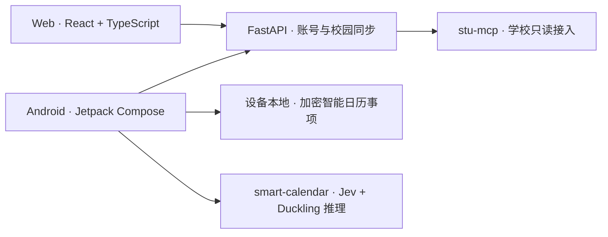

<div align="center">
  <picture>
    <source media="(prefers-color-scheme: dark)" srcset="web/public/truth-bell-dark-256.png">
    
  </picture>

  <h1>STU 事项助手</h1>

  <p>下一节课在哪，作业几点截止。</p>

  <p>把课表、课程动态、个人事项和校园信息收在一处。</p>

  <p>
    <a href="https://stu.oyishi.asia">服务入口</a> ·
    <a href="#本地开发">本地开发</a> ·
    <a href="#文档导航">开发文档</a> ·
    <a href="https://github.com/csensicrigley-netizen/stu-assistant/issues">问题反馈</a>
  </p>
</div>

STU 事项助手由学生共同开发，面向汕头大学同学，提供 **Android 原生 App** 和 **网页版**。Android 使用 Jetpack Compose，网页使用 React；两端共用校园账号连接与同步服务，Android 新增的智能日历事项在设备本地加密保存。

> 本项目与学校官方无关。校园接入只读取本人账号有权查看的内容，不代签到、不提交作业、不缴费；个人事项的创建和完成仅属于助手自身的数据操作。

## 能做什么

| 入口 | 功能 |
| --- | --- |
| 今天 | 查看当前和下一节课、上课倒计时、教室位置，以及当天课程和空档 |
| 课表 | 查看整学期课程、周次、调课与停课信息，打开课程详情 |
| 事项 | 查看个人事项与课程动态；Android 支持自然语言或手动新建、三天日历调整、详情和完成状态 |
| 学业 | 从事项页进入考试安排与成绩查询 |
| 校园 | 查询充电桩空闲端口、图书馆开放时间、到校交通和常用服务入口 |
| 我的 | 连接校园账号，管理外观、通知偏好和本地数据 |
| 首页消息 | 展示维护者配置的图文公告、链接和动效，内容与展示规则可在服务器更新 |

Android 提供原生液态玻璃材质、深浅外观和触感设置。网页版保留校园信息功能，暂未实现与 Android 智能日历等价的交互。

当前还有几项明确的功能限制：

- 新智能日历事项保存在本设备，尚未提供跨设备同步；保存后的完整编辑、删除和设备提醒调度尚未接入。
- 课程动态尚未接入 Jev 自动分类。
- 实时活动与各厂商系统岛仍有独立机型验证，不能视为已支持所有手机上的课程或事项自动提醒。
- 到校交通提供线路和查询入口，不提供实时公交到站。

当前产品源码版本为 **1.1.11 / code67**，以 [Android 构建配置](web/android/app/build.gradle) 为准；对应的 APK、网页和服务端是否已交付，需要分别核验。历史版本和机型实验见[版本与验证构建](docs/版本与验证构建.md)，其中的版本号属于对应阶段记录。

Android 真理钟开屏、动画期间操作和旧系统兼容范围见[开屏更新说明](docs/真理钟开屏更新.md)。

## 架构



| 部分 | 技术与职责 |
| --- | --- |
| Android | Kotlin、Jetpack Compose、AndroidLiquidGlass、Kyant Shapes；负责原生页面、交互和本地事项 |
| 网页 | React 19、TypeScript、Vite；提供校园信息界面和主屏安装入口 |
| 业务后端 | FastAPI、SQLite；处理平台账号、学校授权、同步调度和按用户隔离的校园缓存 |
| 学校接入 | [stu-mcp](https://github.com/0error0warning/stu-mcp)；复用学校登录、会话和数据解析 |
| 日历推理 | [smart-calendar](https://github.com/0error0warning/smart-calendar)；用户主动提交新建请求时调用 Jev 与 Duckling |

历史 Capacitor 模块仍作为构建和迁移依赖保留；当前原生交付包由 Compose 提供界面，不夹带网页业务 bundle。网页支持主屏安装，但当前停用了 Service Worker 离线缓存。

“事项本地保存”指新增的 Android 智能日历业务；既有校园缓存、学校会话和旧计划仍由业务后端管理。Jev Key 保留在推理服务端。详细数据流见[事项 V1 架构与接口](docs/事项V1架构与接口.md)。

## 本地开发

建议准备 **Python 3.12** 和 **Node.js 22**。Android 开发另需 **JDK 21**、Android SDK API 37 和 Build Tools 36.0.0；Gradle 使用仓库内的 wrapper。

先获取源码：

```bash
git clone https://github.com/csensicrigley-netizen/stu-assistant.git
cd stu-assistant
```

### 1. 启动后端演示服务

演示模式使用示例数据，不连接学校系统，也不需要校园账号。以下命令在仓库根目录开始执行。

**Windows / PowerShell：**

```powershell
cd backend
python -m venv .venv
.\.venv\Scripts\python.exe -m pip install -c constraints.txt -r requirements.txt wheels/stu_mcp-0.7.3-py3-none-any.whl

$env:STU_APP_DEMO = "true"
$env:STU_APP_HOME = "./data"
.\.venv\Scripts\python.exe -m uvicorn app.main:app --host 127.0.0.1 --port 8100
```

<details>
<summary>Linux / macOS</summary>

```bash
cd backend
python3 -m venv .venv
.venv/bin/python -m pip install -c constraints.txt -r requirements.txt wheels/stu_mcp-0.7.3-py3-none-any.whl
STU_APP_DEMO=true STU_APP_HOME=./data .venv/bin/python -m uvicorn app.main:app --host 127.0.0.1 --port 8100
```

</details>

### 2. 启动网页

另开终端，在仓库根目录执行：

```bash
cd web
npm ci
npm run dev
```

打开 [http://localhost:5180](http://localhost:5180)。Vite 将 `/v1` 请求代理到 `127.0.0.1:8100`。也可先用[界面预览](http://localhost:5180/?preview=1)查看页面；预览使用内置数据，不表示真实账号同步已经成功。

### 3. 开发 Android

Android 源码位于 `web/android`。首次检出需要先准备 Node、Capacitor 构建依赖和 Android SDK，步骤见[原生构建、验收与交付](docs/事项V1验收与交付.md#1-环境和入口)；自动构建配置见 [Android CI](.github/workflows/android.yml)。

App 内置后台地址由 [native-config.json](web/android/app/src/main/assets/native-config.json) 管理。开发自建后台时需同步检查登录迁移来源，不能只修改单个地址。

## 配置与部署

| 环境变量 | 用途 |
| --- | --- |
| `STU_APP_HOME` | 数据目录，包含 SQLite 和按用户隔离的学校会话；默认 `/data/stu-app` |
| `STU_APP_JWT_SECRET` | 平台登录令牌签名密钥；正式模式必须设置至少 32 字符的随机串 |
| `STU_APP_DEMO` | 设为 `true` 使用示例数据 |
| `STU_APP_CORS_ORIGINS` | 允许的跨域来源；同源部署的浏览器无需额外配置 |
| `STU_APP_WEB_DIR` | 前端构建产物目录；设置后由后端同时托管网页版 |
| `STU_APP_ANNOUNCEMENTS_FILE` | 首页消息配置路径，默认 `$STU_APP_HOME/announcements.json` |

配置参考 [`.env.example`](.env.example)，运行时通过进程环境传入；仅复制该文件不会自动加载配置。

正式部署前先构建网页，并准备部署包。服务器安装脚本要求包含 `web/index.html` 的成品目录，不能直接把尚未构建的源码检出当作安装包。Linux 服务安装、更新和备份见[部署说明](deploy/README.md)；其中旧 Capacitor 打包命令不作为当前原生 App 的交付入口。

Android 完整本机验证包通过 `deploy/make-native-release.ps1 -Variant Haptics` 生成，要求 Git 检出、已提交的干净源码和高于已交付下限的版本号。正式签名和线上发布另行核验，详见[原生交付规则](docs/事项V1验收与交付.md#6-构建与交付规则)。

首页消息的文字、图片、按钮、展示频率与有效期可通过服务器 JSON 热更新，配置见[首页消息配置](docs/首页消息配置.md)；首次启用需要同时更新后端和客户端，维护者可按[操作手册](docs/首页消息-服务器维护者操作手册.md)执行。

## 验证与协作

在已安装依赖的开发环境中运行与改动相关的检查：

```bash
# 仓库根目录：版本一致性与版本策略
python deploy/sync-version.py
python -m unittest discover -s deploy/tests -v

# web/：网页测试与生产构建
npm test
npm run build
```

后端自检使用已安装依赖的 Python，在 `backend/` 运行：

```bash
python tests/check_static.py
python tests/check_stu_mcp.py
python tests/check_sync.py
```

这三份脚本自行准备隔离的测试目录和配置，覆盖静态资源、学校接入接口兼容性、同步与租户隔离，不需要学校登录。Android 编译、单元测试、Lint 和设备回归命令见[验收文档](docs/事项V1验收与交付.md)与 [CI 工作流](.github/workflows/android.yml)。

欢迎提交 [Issue](https://github.com/csensicrigley-netizen/stu-assistant/issues) 或 [Pull Request](https://github.com/csensicrigley-netizen/stu-assistant/pulls)。问题反馈请附应用版本、设备与系统、复现步骤，以及经过脱敏的截图或日志；涉及 UI 交互时可附录屏。PR 请说明变化、验证范围和未完成事项，并区分模拟器结果、真机结果和线上发布状态。

## 数据与授权

- 学校接入按本人授权进行；OA 读取需要单独授权，可撤回授权或删除账号与数据。
- 学校会话和可选“记住密码”数据按用户隔离加密保存在服务端；动态令牌由本人当场输入，不保存或代输。
- 服务端同时持有会话密文和解密所需的密钥，服务器管理员在技术上具有读取能力，使用前应了解所连接服务的维护者。
- Android 新智能日历事项在本设备加密保存，不应把卸载或清除数据作为排障的默认步骤。
- 真实账号、密码、动态码、会话、签名材料及原始用户数据不应进入仓库或问题报告。

完整说明见[授权与边界](docs/授权与边界.md)。

## 文档导航

| 内容 | 文档 |
| --- | --- |
| 设计规格与交互取舍 | [DESIGN.md](DESIGN.md) |
| 事项 V1 的范围、流程与历史交付 | [事项升级 V1](docs/事项升级V1.md) |
| 事项模块与接口 | [事项 V1 架构与接口](docs/事项V1架构与接口.md) |
| Android 环境、验证和交付 | [事项 V1 验收与交付](docs/事项V1验收与交付.md) |
| 历史版本与独立机型实验 | [版本与验证构建](docs/版本与验证构建.md) |
| 学校数据源与接口接入 | [接口接入手册](docs/接口接入手册.md) |
| 医学院教务 | [医学院教务接口](docs/医学院教务接口.md) |
| 首页公告与服务器维护 | [消息配置](docs/首页消息配置.md) · [维护者手册](docs/首页消息-服务器维护者操作手册.md) |
| 部署、升级与备份 | [部署说明](deploy/README.md) |

[PLAN.md](PLAN.md) 和部分早期开发说明保留了 Flutter、Capacitor 等历史方案；当前架构以本 README、现有源码和对应原生验收文档为准。

## 致谢与许可

感谢以下开源项目：

- [stu-mcp](https://github.com/0error0warning/stu-mcp)：学校登录与解析层。
- [smart-calendar](https://github.com/0error0warning/smart-calendar)：独立日历推理服务。
- [AndroidLiquidGlass](https://github.com/Kyant0/AndroidLiquidGlass) 与 [Shapes](https://github.com/Kyant0/Shapes)：原生材质与连续形状。
- [compose-animations](https://github.com/skydoves/compose-animations)：数字动画参考，Apache-2.0 声明保留在原生 assets/licenses。

其他日历布局和手势参考项目、固定源码版本及取舍见 [DESIGN.md](DESIGN.md)。

本项目使用 [MIT License](LICENSE)。

## 支持这个项目

[](https://afdian.com/a/oyishi)

服务器、域名、证书、外部识别调用都是我自掏腰包在扛，站内没有广告，也不会拿你的课表作业数据换钱。

如果它让你少迟到过一次、少错过一次作业，可以到 **[爱发电](https://afdian.com/a/oyishi)** 请我喝杯咖啡；不赞助也完全不影响使用，功能一点不少给。赞助的同学提需求，我会优先排期。

> 入驻公告：https://github.com/csensicrigley-netizen/afdian
