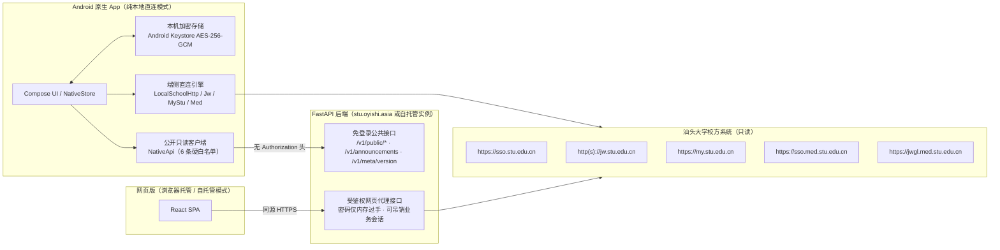

<div align="center">
  <picture>
    <source media="(prefers-color-scheme: dark)" srcset="web/public/truth-bell-dark-256.png">
    
  </picture>

  <h1>STU 事项助手</h1>

  <p>下一节课在哪，作业几点截止。</p>

  <p>面向汕头大学同学的开源课表、事项与校园信息工具，提供 Android 原生 App、网页版与可自托管后端。</p>

  <p>
    <a href="https://stu.oyishi.asia">服务入口</a> ·
    <a href="#架构与数据流向">架构与数据流向</a> ·
    <a href="#独立核验与安全边界">独立核验与安全边界</a> ·
    <a href="#本地开发测试与构建">本地开发与构建</a> ·
    <a href="https://github.com/csensicrigley-netizen/stu-assistant/issues">问题反馈</a>
  </p>
</div>

> 本项目为学生开源项目，与汕头大学官方无关。校内接入严格采用只读方式，仅读取本人账号本就有权查看的数据，不代签到、不提交作业、不选课退课、不缴费、不提交报修；课程与通知信息以学校官方原文为准。

## 项目简介与当前版本

当前产品版本为 **`1.2.1`（`versionCode 69`）**，以 [`web/android/app/build.gradle`](web/android/app/build.gradle)、[`web/src/lib/version.ts`](web/src/lib/version.ts) 与 [`backend/app/latest_version.json`](backend/app/latest_version.json) 为准（仓库通过 `python deploy/sync-version.py` 校验三端版本号一致）。

仓库包含三个部分：

- **Android 原生 App（`web/android`）**：Kotlin + Jetpack Compose（`minSdk 24`、`targetSdk 36`、`compileSdk 37`）。自 `1.2.0` 起采用**纯本地直连模式**，免注册、免登录服务端账号，由手机直接连接学校系统，个人课表、作业、成绩、考试、计划与日历事项仅加密保存在设备本地。
- **网页版（`web`）**：React 19 + TypeScript + Vite，用于浏览器访问及添加到主屏（当前停用 Service Worker 离线缓存）。
- **FastAPI 后端（`backend`）**：Python FastAPI + SQLite。对 Android 端仅提供 6 个免登录公开接口（公开通知、公交、充电桩、首页公告、版本检查及用户主动触发的一次性匿名 today 课表中转）；同时为网页版及自托管用户提供后端代理认证与数据缓存。

### 核心能力

| 模块 | 说明 |
| --- | --- |
| 今日课表（今天） | 按汕头大学教务处官方 13 节作息时间表展示当前/下一节课、上课倒计时、教室位置、全天课程与空档 |
| 周课表（课表） | 查看整学期课表、周次范围、单双周、调课/停课标注与课程详情；Android 端支持在本部教务、医学院教务与手动课表之间切换 |
| 事项与日历（事项） | 汇总 MySTU 作业/课程动态、个人计划与本地日历事项；Android 端支持离线本地时间文本解析（`ItemsQuickParser`）、三天日历视图调整、编辑、删除与完成状态管理 |
| 考试与成绩（学业） | 查看学期考试安排与课程成绩（支持本部教务与医学院教务） |
| 校历与作息 | 内置教务处 2026–2027 学年教学校历与 13 节官方作息时间锚点 |
| 公开校园信息（校园） | 免登录查看学校官网公开通知、桑浦山校区公交线路与官方查询入口、已核验校内充电桩实时空闲端口，以及图书馆与常用校园入口 |
| 医学院教务 | 适配汕头大学医学院强智教务系统（`jwgl.med.stu.edu.cn`），支持统一认证（免图形验证码）和教务本地口令（RSA-512 + 图形验证码）两种只读接入 |
| 手动导入课表 | 支持粘贴纯文本、导入 CSV（内置 UTF-8 BOM 模板）或逐条录入；Android 端完全离线解析、校验与保存 |
| 导入到 today | 用户主动点击「导入到 today」后，将剥离个人身份字段的课表快照换取 12 位一次性短码（5 分钟有效、单次消费）与 `today://sheet/stu-import?code=...` 链接，导入配套应用 [today](https://today.oyishi.asia/) |
| 外观与首页消息 | Android 端提供液态玻璃与简约界面材质、深浅外观、6 款校园色系与触感强度设置；首页支持读取服务器公开 JSON 图文消息并本地记录「不再提醒」 |

### 已知限制

- Android 端个人课表、计划与日历事项仅保存在本机加密存储中，不提供跨设备云同步；卸载应用或执行「重置本机全部数据」后无法从服务器恢复。
- 到校交通仅提供线路信息与官方查询入口，不提供未经上游授权的实时公交到站倒计时。
- 实时活动与各厂商系统实况窗仍以独立探针变体（`liveprobe`、`huaweiprobe`、`vivoprobe` 等）验证，不视为已在全部机型上支持课程自动系统岛提醒。
- 网页版侧重浏览器查阅与自托管使用，暂未提供与 Android 端等价的三天日历交互与液态玻璃材质。

---

## 架构与数据流向



### Android 端 vs 网页端精确对比

| 维度 | Android 原生 App（纯本地直连） | 网页版（浏览器托管 / 自托管） |
| --- | --- | --- |
| 服务端账号 | 无需注册或登录 `stu.oyishi.asia` 账号 | 需注册并登录后端服务账号 |
| 校内认证路径 | 手机端直接连接学校域名完成认证与解析 | 受浏览器 CORS 与混合内容限制，由后端代理向学校认证 |
| 学校密码流向 | 仅发往学校 HTTPS 认证接口；可选在本机加密保存以便会话过期时端侧自动重连，不发往开发者服务器 | 仅在本次登录/重连请求的后端进程内存中用于向校方认证；后端不落盘、不入库、不入日志、不进备份；浏览器 `localStorage` 不再保存明文密码 |
| 校内会话存储 | 仅业务域 Cookie / Token 经 Android Keystore AES-256-GCM 存于本机；中央 SSO Cookie 仅存内存、认证结束即清空 | 按用户隔离的租户目录保存可吊销业务会话（本部仅 `jw`/`mystu`，医学院 Token 经 Fernet 加密存库），不纳入定期备份 |
| 个人课表 / 成绩 / 作业 / 计划 / 事项 | 全部仅存于本机加密存储（`noBackupFilesDir` 与私有 `SharedPreferences`） | 缓存在所连接后端的 SQLite 数据库中 |
| 发往 `stu.oyishi.asia` 的请求 | 仅限 6 个白名单公开接口，代码层硬拦截其余路由且不携带 `Authorization` 头 | 使用账号 Bearer Token 访问受鉴权 `/v1/*` 接口 |
| 信任前提 | 无需信任服务端保管校园密码或个人课表；只需信任本机环境与所用安装包源码/签名 | 使用托管网页版需信任对应服务器的维护者；如需自主掌控可改用 Android 端、手动导入或自行部署后端 |

### 1. Android 端（纯本地直连模式）明细

#### 免注册与路由硬隔离

- 应用启动即进入纯本地模式，不要求注册或登录 `stu.oyishi.asia`，`NativeSession` 不携带认证令牌。
- 从旧版（`1.1.11` 及更早版本）覆盖升级至 `1.2.0` 时，`NativeStore.migrateV1ToLocalIfNeeded()` 会将本机已缓存的课表、完成标记、本地日历事项及曾在本机记住的校园密码迁入本地加密存储，同时清除历史遗留的服务端 JWT 会话记录。
- [`NativeApi.kt`](web/android/app/src/main/java/com/stuassistant/app/nativeapp/NativeApi.kt) 通过 `PUBLIC_GET_PATHS`、`PUBLIC_POST_PATHS` 与 `validatePublicRoute()` 对发往公共服务地址的请求执行硬白名单校验，任何非白名单路径或方法（包括 `/v1/auth/*`、`/v1/bind*`、`/v1/med/*`、`/v1/relogin`、`/v1/plan*` 等）均在发起网络请求前直接抛出本地 `blocked_non_public_route` 错误。

#### 直连学校域名与明文 HTTP 例外说明

所有端侧校内客户端（[`LocalSchoolHttp.kt`](web/android/app/src/main/java/com/stuassistant/app/nativeapp/local/LocalSchoolHttp.kt)、`LocalJwClient.kt`、`LocalMyStuClient.kt`、[`LocalMedJwClient.kt`](web/android/app/src/main/java/com/stuassistant/app/nativeapp/local/LocalMedJwClient.kt)）均使用标准 `OkHttpClient` 与 Android 系统默认 TLS 证书及主机名校验，不存在 `TrustAll`、自定义 `X509TrustManager` 或跳过主机名验证的代码。直连域名共 5 个：

| 学校域名 | 协议 | 用途与隔离边界 |
| --- | --- | --- |
| `https://sso.stu.edu.cn` | HTTPS | 本部统一身份认证（`POST /login`）。校园账号与密码仅允许经 HTTPS 提交到此域；登录期使用独立内存容器 `ssoJar`，认证结束在 `finally` 中立即清空，中央 SSO Cookie（含 `TGC` 与父域 `stu.edu.cn`）绝不落盘，也绝不发往明文域或业务域 |
| `http://jw.stu.edu.cn`（及 `https://jw.stu.edu.cn`） | HTTP / HTTPS | 本部正方教务系统（课表、考试、成绩只读）。**明文例外原因**：校方教务 CAS 回调（如 `http://jw.stu.edu.cn/jwglxt/xtgl/login_slogin.html`）目前在学校服务器端强制要求 HTTP。因此 [`network_security_config.xml`](web/android/app/src/main/res/xml/network_security_config.xml) 在全局 `<base-config cleartextTrafficPermitted="false" />` 下，**仅对单个精确域名 `jw.stu.edu.cn`（`includeSubdomains="false"`）放行明文**。`LocalSchoolHttp.kt` 通过 `ssoJar` 与 `schoolJar` 严格分桶、在明文请求前执行 `assertOnlyHost("jw.stu.edu.cn")` 并禁止向非 HTTPS 地址提交密码字段，防止中央 SSO Cookie 或密码进入明文链路 |
| `https://my.stu.edu.cn` | HTTPS | 本部 MySTU 课程列表与 Moodle（ELC / Campus）作业只读。仅在必要时将限定为 `my.stu.edu.cn`、`secure=true`、`hostOnly=true` 的服务令牌桥接至业务容器 |
| `https://sso.med.stu.edu.cn` | HTTPS | 医学院统一身份认证（`/cas/login`），仅在独立临时内存 `casJar` 中换取单次 CAS 票据，结束后立即清空 |
| `https://jwgl.med.stu.edu.cn` | HTTPS | 医学院强智教务系统（`/dev-api/appapi/*`），支持 CAS 换取令牌与本地口令（RSA-512 + 图形验证码）登录；通过 `LocalMedJwClient.READ_PATHS` 白名单强制只读课表、成绩与考试 |

#### 发往 `stu.oyishi.asia` 的 6 个白名单接口

以下为 [`NativeApi.kt`](web/android/app/src/main/java/com/stuassistant/app/nativeapp/NativeApi.kt) 中允许发往 `stu.oyishi.asia` 的全部 API 路由，均**不携带 `Authorization` 请求头**：

| 方法 | 路径 | 用途 | 发送内容说明 |
| --- | --- | --- | --- |
| `GET` | `/v1/public/notices` | 获取学校官网公开栏目通知（如 `?limit=30`） | 无个人身份参数；服务端仅读全局公开缓存 |
| `GET` | `/v1/public/bus` | 获取桑浦山校区公交线路与官方查询口径 | 无个人身份参数 |
| `GET` | `/v1/public/charging` | 获取已核验校内充电桩设备及空闲端口状态 | 无个人身份参数 |
| `GET` | `/v1/announcements` | 获取首页公开图文公告（如 `?platform=android&version_code=69`） | 仅携带平台与构建版本号；若公告配置了站内图片，另按公开路径 `GET /v1/announcements/assets/<filename>` 或 HTTPS 图片地址加载图片 |
| `GET` | `/v1/meta/version` | 检查当前版本是否有新版本更新说明（如 `?name=1.2.1&code=69`） | 仅携带应用版本号与 `versionCode`；点击更新时交由系统浏览器下载 APK |
| `POST` | `/v1/public/export/today` | **仅在用户主动点击「导入到 today」时触发**，生成 12 位一次性导入码 | 客户端先通过 `sanitizeTimetableForTodayExport` 剥离学号、姓名、邮箱、Cookie 等字段，仅上传白名单课表结构；服务端校验体积 `<= 128 KB`、课程 `<= 80`、每课节次 `<= 30` 并再次剥离非白名单字段，短码经 SHA-256 哈希存库，有效期 300 秒，被 `POST /v1/export/today/claim` 消费一次即失效 |

#### 本机加密存储与数据清理

- [`NativeSecureStorage.kt`](web/android/app/src/main/java/com/stuassistant/app/nativeapp/NativeSecureStorage.kt) 使用 Android Keystore 生成并托管 256 位设备绑定密钥（别名 `com.stuassistant.app.native.storage.v1`），采用 `AES/GCM/NoPadding`（12 字节随机 IV、128 位认证标签、按域与键名绑定的 AAD）对所有本地课表/学业缓存（原子写入 `noBackupFilesDir/native-encrypted-cache-v1/`）与敏感凭据（`SharedPreferences: stu.native.secure.v1`）进行加密存储。
- [`AndroidManifest.xml`](web/android/app/src/main/AndroidManifest.xml) 配置 `android:allowBackup="false"` 与 `android:usesCleartextTraffic="false"`，阻止 Android 系统自动云备份或 ADB 备份导出应用私有目录。
- 本部直连页的「在本机加密记住校园密码」为可选项：开启时密码仅存于本机 Keystore 加密存储，供会话过期时由手机直接重连学校；关闭时本机不保存密码。
- 在「我的」页面随时可执行两级清理：
  - **清除校园登录凭据**：删除本机保存的校园密码、教务/MySTU Cookie 与医学院 Token，保留已缓存的课表和个人事项；
  - **重置本机全部数据**：清空本机全部课表、作业、考试、成绩、个人计划、日历事项、登录凭据与历史迁移数据。

### 2. 网页端（浏览器托管 / 自托管模式）明细

- **为何需要后端代理**：现代浏览器执行同源策略（CORS），且 HTTPS 页面会阻止向 `http://jw.stu.edu.cn` 发起明文混合内容请求，浏览器无法直接完成校内 CAS 跳转与跨站 Cookie 读取，因此网页版需由后端代理完成学校系统认证与数据抓取。
- **后端凭据处理与加固**：
  - 用户在网页端提交校园账号与密码时，密码仅在单次登录或重连请求的后端进程内存中用于向校方认证，认证后随即丢弃；后端不再写入 `credentials.enc`，**密码不落盘、不入数据库、不入日志、不进备份**。
  - 已停用 `/v1/webvpn/auto` 对动态口令种子的服务端保存，本部绑定范围收窄为 `jw` 与 `mystu`（移除 `repair`），医学院会话 `med_sessions.token` 经 Fernet 加密后写入 SQLite；SQLite 初始化启用 `PRAGMA secure_delete = ON`；`deploy/stu-assistant.service` 配置 `LimitCORE=0` 禁止崩溃内存转储；`deploy/stu-backup.sh` 仅备份业务数据库而不备份 `tenants/` 会话目录。
  - 网页前端不再将校园密码明文写入浏览器 `localStorage`（读取或退出时自动清理历史遗留键）。
  - 平台登录令牌支持登出即时吊销（递增 `token_version`）；用户可随时通过「我的 → 删除账号和数据」（`DELETE /v1/account`）清理服务端租户目录与数据库记录。
- **信任边界**：使用第三方托管的网页版时，认证请求与已登录的校内业务会话会经过并保存在该服务器上，服务器维护者在技术上具备访问宿主机内存与磁盘密钥的能力。如果你不希望校园账号或课表数据经过他人维护的服务器，建议使用 **Android 原生端**、使用**手动导入**，或参考下文**自行部署本开源后端**。

---

## 独立核验与安全边界

### 官方正式版签名证书指纹

公开发布的官方正式版 Android 安装包（`applicationId: com.stuassistant.app`）使用同一签名证书签发，公开指纹如下：

- **证书主题（DN）**：`CN=STU Assistant`
- **SHA-256 指纹**：`2e3150e49b42ec94eb94b0d63fb25f2c79717f06ff381982fe16ca9471e3cbc1`

### 自行核验方法

1. **核验预编译 APK 签名**（需 Android SDK Build Tools 中的 `apksigner`）：

   ```bash
   apksigner verify --verbose --print-certs stu-assistant.apk
   ```

   核对输出中 `Signer #1 certificate DN` 为 `CN=STU Assistant`，且 `Signer #1 certificate SHA-256 digest` 与上方 `2e3150e49b42ec94eb94b0d63fb25f2c79717f06ff381982fe16ca9471e3cbc1` 完全一致。

2. **从源码自行编译核验**：

   克隆本仓库后，可直接审阅以下关键文件并自行运行 Gradle 编译：
   - [`web/android/app/src/main/java/com/stuassistant/app/nativeapp/NativeApi.kt`](web/android/app/src/main/java/com/stuassistant/app/nativeapp/NativeApi.kt)（主站 6 条公开路由硬白名单）
   - [`web/android/app/src/main/java/com/stuassistant/app/nativeapp/local/LocalSchoolHttp.kt`](web/android/app/src/main/java/com/stuassistant/app/nativeapp/local/LocalSchoolHttp.kt) 与 [`LocalMedJwClient.kt`](web/android/app/src/main/java/com/stuassistant/app/nativeapp/local/LocalMedJwClient.kt)（端侧直连与 Cookie 隔离）
   - [`web/android/app/src/main/java/com/stuassistant/app/nativeapp/NativeSecureStorage.kt`](web/android/app/src/main/java/com/stuassistant/app/nativeapp/NativeSecureStorage.kt)（Android Keystore AES-256-GCM 封装）
   - [`web/android/app/src/main/res/xml/network_security_config.xml`](web/android/app/src/main/res/xml/network_security_config.xml) 与 [`AndroidManifest.xml`](web/android/app/src/main/AndroidManifest.xml)

3. **在本机抓包验证 Android 端网络行为**：

   在测试设备上配置代理或本地 VPN 抓包工具，依次执行「首次打开 → 连接本部教务 / MySTU 或医学院教务 → 同步课表、成绩、考试 → 新建本地事项 → 打开校园通知、公交、充电桩」：
   - 观察发往 `stu.oyishi.asia` 的流量，可确认仅出现上述白名单公开路径，不带 `Authorization` 头，不含学号、密码、校内 Cookie 或个人事项；
   - 校园登录与课表同步请求仅直接发往 `sso.stu.edu.cn`、`jw.stu.edu.cn`、`my.stu.edu.cn`、`sso.med.stu.edu.cn`、`jwgl.med.stu.edu.cn`；
   - 仅当手动点击「导入到 today」时才会发出 `POST /v1/public/export/today`，请求体仅含脱敏后的课表 JSON。

### 无法消除的外部边界

任何客户端软件都存在自身架构无法消除的外部依赖与边界，以下情况需要如实了解：

- **学校认证与教务侧日志及明文回调**：无论直连还是代理，向学校系统发起登录与查询都会在学校服务器端留下常规访问与认证日志；此外，本部教务 `jw.stu.edu.cn` 的 CAS 回调与部分页面由校方配置为明文 HTTP，在不可信的公共 Wi-Fi 网络中存在被同网段监听该教务会话的风险（客户端已隔离中央 SSO Cookie 与密码，但无法单方面将校方服务升级为 HTTPS）。
- **用户本机系统环境**：Android Keystore 与应用私有目录依赖手机操作系统与锁屏安全边界；若设备已 Root / 解锁 Bootloader、安装了恶意高权限软件或未锁屏被他人物理操作，本机加密数据仍可能受损。
- **预编译安装包的构建链信任**：校验 APK 签名仅证明安装包由持有上述签名私钥的发布者构建且下载过程未被篡改，但仍需信任发布者使用的构建源码与本仓库一致；若希望去除这一信任前提，可按本仓库说明直接从源码自行构建。
- **托管网页版服务器权限**：使用非自托管网页版时，服务器管理员在技术上拥有宿主机的运维与读取权限。

---

## 目录结构

```text
stu-assistant/
├── backend/                     # FastAPI 后端、公共缓存、网页代理与 pytest 测试
│   ├── app/                     # API 路由、公共接口、today 一次性导出、医学院适配、公告与版本元数据
│   ├── tests/                   # pytest 单元测试与离线静态/同步检查脚本
│   └── wheels/                  # 固定版本的 stu-mcp v0.7.3 wheel 及 SHA256SUMS
├── web/                         # React + TypeScript + Vite 网页版
│   ├── src/                     # 网页端页面与逻辑
│   ├── tests/                   # Node 测试与工具脚本
│   └── android/                 # Android 原生 Kotlin + Jetpack Compose 工程
│       └── app/src/main/
│           ├── java/.../nativeapp/        # 原生 UI、NativeStore、NativeApi、NativeSecureStorage
│           ├── java/.../nativeapp/local/  # 端侧直连引擎与离线导入解析器
│           └── res/xml/network_security_config.xml
├── deploy/                      # 版本同步脚本、Linux 安装/备份脚本、systemd 与 Nginx 配置模板
├── docs/                        # 设计规格、接口手册、验收文档与维护手册
└── .github/workflows/android.yml # 覆盖版本一致性、后端、Web 与 Android 的完整 CI 流水线
```

---

## 本地开发、测试与构建

### 环境要求

- **Python 3.12**（`stu-mcp` 要求 `>= 3.11`）
- **Node.js 22**
- **Android 构建**：**JDK 21**、Android SDK **API 37**（`platforms;android-37.0`）与 **Build Tools 36.0.0**（使用仓库内置 Gradle wrapper）

```bash
git clone https://github.com/csensicrigley-netizen/stu-assistant.git
cd stu-assistant
```

### 1. 后端开发与测试

演示模式使用内置示例数据，不连接学校系统。

**Windows / PowerShell：**

```powershell
cd backend
python -m venv .venv
.\.venv\Scripts\python.exe -m pip install -c constraints.txt -r requirements.txt wheels/stu_mcp-0.7.3-py3-none-any.whl pytest

$env:STU_APP_DEMO = "true"
$env:STU_APP_HOME = "./data"
.\.venv\Scripts\python.exe -m uvicorn app.main:app --host 127.0.0.1 --port 8100
```

<details>
<summary>Linux / macOS</summary>

```bash
cd backend
python3 -m venv .venv
.venv/bin/python -m pip install -c constraints.txt -r requirements.txt wheels/stu_mcp-0.7.3-py3-none-any.whl pytest
STU_APP_DEMO=true STU_APP_HOME=./data .venv/bin/python -m uvicorn app.main:app --host 127.0.0.1 --port 8100
```

</details>

在仓库根目录运行后端编译与完整离线 `pytest` 套件（使用已安装后端依赖的 Python）：

```bash
python -m py_compile backend/app/*.py backend/app/push/*.py
python -m pytest \
  backend/tests/test_public_endpoints.py \
  backend/tests/test_zero_password_persistence.py \
  backend/tests/test_today_export.py \
  backend/tests/test_announcements.py \
  backend/tests/test_account_cleanup.py \
  backend/tests/test_med_regressions.py \
  backend/tests/test_push.py -v
```

另可在 `backend/` 目录下运行独立离线自检脚本：

```bash
python tests/check_static.py
python tests/check_stu_mcp.py
python tests/check_sync.py
```

### 2. 网页端开发、测试与构建

在 `web/` 目录执行：

```bash
cd web
npm ci
npm run dev        # 打开 http://localhost:5180（代理 /v1 到 127.0.0.1:8100；加 ?preview=1 可预览内置数据）
```

类型检查、单元测试与生产构建：

```bash
cd web
npm run typecheck
npm test
npm run build
```

> 说明：`web/index.html` 中用于防首帧闪烁的内联主题脚本受 Nginx CSP `script-src` SHA-256 白名单约束（见 [`deploy/nginx/stu-headers.conf`](deploy/nginx/stu-headers.conf)）。若修改该段脚本，需同步更新对应哈希，CI 会在每次提交时自动校验。

### 3. Android 端测试与构建

首次检出构建 Android 前，需先在 `web/` 准备构建期 Capacitor 占位依赖（原生交付包通过 `build.gradle` 中的 `ignoreAssetsPattern` 排除网页业务 bundle，不包含网页界面）：

```bash
cd web
npm ci
mkdir -p dist-android
printf '<!doctype html><title>Native build placeholder</title>' > dist-android/index.html
npx cap update android
```

随后在 `web/android/` 目录运行单元测试、设备测试编译、Lint 与正式包构建（Windows 请将 `./gradlew` 替换为 `.\gradlew.bat`，并确保已设置 `ANDROID_HOME`）：

```bash
cd web/android
./gradlew :app:testDebugUnitTest
./gradlew :app:compileDebugAndroidTestKotlin
./gradlew :app:lintVitalRelease
./gradlew :app:assembleRelease
```

- 公共服务基址配置在 [`web/android/app/src/main/assets/native-config.json`](web/android/app/src/main/assets/native-config.json)。
- 正式签名配置读取仓外路径 `../../android-signing/keystore.properties`（签名材料不入仓库）；未配置签名文件时，`:app:assembleRelease` 会产出未签名包，也可运行 `./gradlew :app:assembleHaptics` 生成独立包名（`com.stuassistant.app.haptics`）、使用 debug 签名的本地验证包，与正式版共存安装。

### 4. 版本一致性校验

在仓库根目录执行：

```bash
python deploy/sync-version.py
python -m unittest discover -s deploy/tests -v
```

完整 CI 校验流程见 [`.github/workflows/android.yml`](.github/workflows/android.yml)，覆盖版本一致性检查、后端 `py_compile` + `pytest`、Web 类型检查/单测/构建/CSP 哈希核验，以及 Android 零上传与 TLS 静态防回归扫描和 Gradle 编译/单测/Lint。

---

## 自托管部署

如需将后端与网页版部署到自己管理的 Linux 服务器，可先参考 [`.env.example`](.env.example) 与 [`deploy/README.md`](deploy/README.md)。核心运行时环境变量如下（由进程环境或 systemd 配置注入，仅复制 `.env.example` 不会自动加载）：

| 环境变量 | 用途 |
| --- | --- |
| `STU_APP_HOME` | 数据目录，存放 SQLite 数据库与按用户隔离的校内会话目录；默认 `/data/stu-app` |
| `STU_APP_JWT_SECRET` | 平台登录令牌签名密钥；正式模式必须提供至少 32 字符的随机串 |
| `STU_APP_DEMO` | 设为 `true` 启动无学校连接的演示模式 |
| `STU_APP_CORS_ORIGINS` | 允许的跨域来源；同源部署网页版无需额外放开 |
| `STU_APP_WEB_DIR` | 前端构建产物 `web/dist` 目录；设置后由 FastAPI 同源托管网页版与静态资源 |
| `STU_APP_ANNOUNCEMENTS_FILE` | 首页消息 JSON 路径，默认 `$STU_APP_HOME/announcements.json` |

部署脚本、systemd 加固配置（含 `LimitCORE=0`）、数据库备份脚本（不打包 `tenants/` 目录）与 Nginx 安全响应头模板位于 [`deploy/`](deploy/) 目录。首页消息格式与热更新流程见 [`docs/首页消息配置.md`](docs/首页消息配置.md) 与 [`docs/首页消息-服务器维护者操作手册.md`](docs/首页消息-服务器维护者操作手册.md)。

---

## 文档导航与协作

| 主题 | 文档 |
| --- | --- |
| 设计规格与交互取舍 | [`DESIGN.md`](DESIGN.md) |
| 学校数据源与接口接入 | [`docs/接口接入手册.md`](docs/接口接入手册.md) |
| 医学院教务接口说明 | [`docs/医学院教务接口.md`](docs/医学院教务接口.md) |
| 事项模块架构、验收与交付 | [`docs/事项V1架构与接口.md`](docs/事项V1架构与接口.md) · [`docs/事项V1验收与交付.md`](docs/事项V1验收与交付.md) |
| 真理钟开屏与历史版本构建 | [`docs/真理钟开屏更新.md`](docs/真理钟开屏更新.md) · [`docs/版本与验证构建.md`](docs/版本与验证构建.md) |
| 首页消息配置与维护 | [`docs/首页消息配置.md`](docs/首页消息配置.md) · [`docs/首页消息-服务器维护者操作手册.md`](docs/首页消息-服务器维护者操作手册.md) |
| 自托管部署与维护 | [`deploy/README.md`](deploy/README.md) |

欢迎通过 [Issue](https://github.com/csensicrigley-netizen/stu-assistant/issues) 或 [Pull Request](https://github.com/csensicrigley-netizen/stu-assistant/pulls) 参与改进。提交反馈或 PR 时请附上版本号、复现步骤与脱敏日志，**切勿提交真实学号、密码、动态口令、Cookie、签名密钥或原始个人学业数据**。

## 致谢与许可

感谢以下开源项目与作者：

- [stu-mcp](https://github.com/0error0warning/stu-mcp)：学校认证协议与教务/MySTU 解析实现（MIT）。
- [AndroidLiquidGlass](https://github.com/Kyant0/AndroidLiquidGlass) 与 [Shapes](https://github.com/Kyant0/Shapes)：Android 原生液态玻璃材质与连续圆角形状。
- [compose-animations](https://github.com/skydoves/compose-animations)：数字动效参考（Apache-2.0 许可声明保留在 Android `assets/licenses` 中）。

更多界面参考、历史演进与取舍说明见 [`DESIGN.md`](DESIGN.md)。

本项目基于 [MIT License](LICENSE) 开源。
