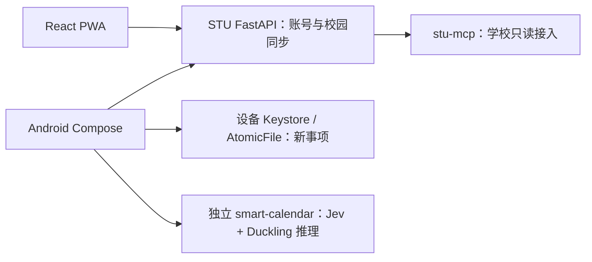

# STU 事项助手

汕头大学校园信息的个人助手：把**教务课表、MySTU 课程动态、个人事项和学校通知**收在一处。Android 使用原生 Jetpack Compose，网页使用 React PWA；校园账号与同步服务共用，新增智能日历事项在设备本地加密保存。

> 本项目是**学生自用**的只读工具，与学校官方无关。
> 只读你本人账号本来就能看到的内容，**不代签到、不交作业、不缴费、不提交任何东西**。

---

## 事项升级 V1

[GitHub 里程碑：事项升级 V1](https://github.com/csensicrigley-netizen/stu-assistant/milestone/1)

本轮完整范围是 **1.0.54 / code55 → 1.1.3 / code59**，涵盖 PR #23–#26：顶部自然语言输入、真实 Jev + Duckling、原生竖向三天日历、直接拖动、设备加密保存，以及事项详情/完成、学业导航和柔化材质修复。

- [首版说明：前后变化、使用流程、边界与版本记录](docs/事项升级V1.md)
- [架构与接口：模块职责、字段、数据流和持久化](docs/事项V1架构与接口.md)
- [验收与交付：构建命令、测试范围、升级与回退](docs/事项V1验收与交付.md)
- [完整代码比较](https://github.com/csensicrigley-netizen/stu-assistant/compare/62e5a2a03af0a04918965175b7225b8ab46b7e88...cc59496d1ec01f33b81d90a2f5e30524db316e5e)

当前是完整 App 的本机验证版本；源码合入、本机 APK 和正式渠道部署分别登记。课程动态 Jev 分类、保存后事项完整编辑/删除及设备提醒调度尚未接入，不能把字段保留或配置入口当作能力已经执行。

## 功能

| 模块 | 内容 |
|---|---|
| 今天 | 现在/下一节课、还剩多久、教室怎么走；今天的课与空档排成一条时间轴 |
| 课表 | 整学期课表、周次、调课与停课、课程详情 |
| 事项 | 自然语言/手动新建、三天日历调整、个人事项与未分类课程动态；学业子页查看考试和成绩 |
| 校园 | 充电桩实时空闲口、图书馆开放时间、到校交通、常用入口 |
| 我的 | 连接校园账号、通知偏好、实时活动开关、清除数据 |

界面细节见 [`DESIGN.md`](DESIGN.md)，需求与取舍见 [`PLAN.md`](PLAN.md)。

---

## 架构



- **Android**：原生 Compose 页面与 AndroidLiquidGlass / Kyant Shapes。历史 Capacitor 模块作为构建和迁移依赖保留，原生交付包不夹带网页业务 bundle。
- **网页**：React + TypeScript + Vite PWA，继续现有校园信息功能；本轮没有实现与原生日历等价的网页交互。
- **STU 后端**：FastAPI + SQLite，负责既有账号、学校授权、同步、校园缓存和旧计划；使用 [`stu-mcp`](https://github.com/0error0warning/stu-mcp) 对接学校。
- **智能日历**：只有推理模块独立建仓于 [`smart-calendar`](https://github.com/0error0warning/smart-calendar)，App 主动提交时调用。Jev Key 留在服务端，新事项在本地保存。

数据本地要求针对新增智能日历业务，不代表既有 STU 校园采集系统已整体改成本地。详细接口及边界见[事项 V1 架构](docs/事项V1架构与接口.md)。

---

## 快速开始（本地）

网页/后端开发需要 **Python 3.12** 与 **Node 22**（CI 版本）。Android 另需 JDK 21 和 Android SDK，见[原生构建步骤](docs/事项V1验收与交付.md)。

```bash
# 后端
cd backend
python -m venv .venv
.venv/Scripts/activate            # Linux/macOS: source .venv/bin/activate
pip install -c constraints.txt -r requirements.txt wheels/stu_mcp-0.7.3-py3-none-any.whl
export STU_APP_DEMO=true          # 演示模式：假数据、不连学校系统
export STU_APP_HOME=./data
uvicorn app.main:app --port 8100
```

```bash
# 前端
cd web
npm ci
npm run dev                       # http://localhost:5180
```

前端开发服务器把 `/v1` 代理到 `127.0.0.1:8100`，两边都起来就能用。

**演示模式**下不需要任何学校账号，界面里全是示例数据，适合先看效果。

---

## 环境变量

| 变量 | 说明 |
|---|---|
| `STU_APP_HOME` | 数据目录（SQLite、租户会话、上传），默认 `/data/stu-app` |
| `STU_APP_JWT_SECRET` | 登录令牌签名密钥。正式模式留空会**拒绝启动**；生成见 `.env.example` |
| `STU_APP_DEMO` | `true` 用假数据、不连学校系统 |
| `STU_APP_CORS_ORIGINS` | 允许的跨域来源；浏览器版同源不需要，打包 App 的 WebView 需要 |
| `STU_APP_WEB_DIR` | 设为 `web/dist` 时，后端同时托管前端静态文件 |

完整示例见 [`.env.example`](.env.example)。

---

## 部署

`deploy/` 里是一键安装脚本，面向一台你自己的 Linux 服务器：

```bash
sudo bash deploy/install.sh <你的域名>
```

它会建系统用户、装 venv、写 systemd 服务、配 Caddy 反代与证书，并跑一次 `app.doctor` 自检。
**安装脚本不包含任何真实域名、IP、密钥**；这些都要你自己填。

Android 开发验证及交付见[事项 V1 验收与交付](docs/事项V1验收与交付.md)：

- 产品版本源是 `web/android/app/build.gradle`，`python deploy/sync-version.py --write` 同步网页和后台数字；机型探针使用独立登记。
- 直接 Gradle 构建用于开发检查；完整 App 本机交付使用 `deploy/make-native-release.ps1 -Variant Haptics`，要求已提交的干净源码和高于已交付下限的 versionCode。
- 当前本机已交付包为 `1.1.3-native.1 / 59`，源码和哈希见[首版记录](docs/事项升级V1.md#9-已交付包与验收证据)。本轮整理不重新生成同版本交付包。
- APK、签名和含源码 SHA/版本/哈希的构建回执保留本机 `release/`，不上传 GitHub。正式 `.app` 签名、网站下载和生产部署另行验收；提交版本常量不等于已经发布。
- 内置后台由 `web/android/app/src/main/assets/native-config.json` 提供，默认 `https://stu.oyishi.asia`；空地址和保留示例域名会阻止构建，学生不填写服务器。Jev Key 不进入 App。

历史完整 App、机型探针和网页源码变化见[版本与验证构建](docs/版本与验证构建.md)。

---

## 测试

```bash
cd backend
STU_APP_DEMO=true STU_APP_HOME=./tmp python tests/check_static.py
STU_APP_DEMO=true STU_APP_HOME=./tmp python tests/check_stu_mcp.py
STU_APP_DEMO=true STU_APP_HOME=./tmp python tests/check_sync.py

cd ../web
npm test
npm run build
```

三份自检分别覆盖：静态资源与安全头、stu-mcp 集成与租户隔离、同步编排与限流。

---

## 授权与边界（重要）

详见 [`docs/授权与边界.md`](docs/授权与边界.md)。要点：

- **账号密码由使用者本人输入**，勾选记住时加密存在**该用户自己的租户目录**里，用于会话过期后自动重连
- **动态令牌（如数盾 OTP）由本人当场输入**，服务器不生成、不保存、不代输、不转发
- **本人授权**：读 OA 通知前必须由本人在界面上勾选授权（`POST /v1/consent`），没有这条记录连 WebVPN 都不放行
- **只读**：不向学校任何系统写入或提交；不代签到、不代缴费、不代交作业
- **可撤回**：`DELETE /v1/consent` 立刻停止读取；`DELETE /v1/account` 连租户目录一起删除
- 数盾、统一认证等均为学校方系统，本项目不绕过任何认证环节

---

## 不做什么

- 不接「车来了」实时公交（上游禁止第三方访问，宁可空着也不编造到站时间）
- 不在 App 内转载树洞内容
- 不用环境变量切换租户、不共用会话目录
- 不猜解密码、不爆破、不伪造令牌

---

## 目录

```
backend/
  app/            后端源码（main.py 是路由，collectors.py 是采集，sync.py 是编排）
  tests/          三份自检脚本
  wheels/         stu-mcp 的官方 wheel（MIT）
web/
  src/            React 源码（screens/ 页面、components/ 组件、lib/ 逻辑）
  scripts/        打包与截图脚本
  android/        原生 Compose App；保留既有 Capacitor 构建/迁移依赖
deploy/           安装与发布脚本
docs/             数据契约、官方来源、能力地图、授权边界、接口手册
```

---

## 致谢

- [`stu-mcp`](https://github.com/0error0warning/stu-mcp)（MIT）：学校登录与解析层，没有它这个项目无从谈起
- [AndroidLiquidGlass](https://github.com/Kyant0/AndroidLiquidGlass) / [Shapes](https://github.com/Kyant0/Shapes)：原生材质和连续形状
- [compose-animations](https://github.com/skydoves/compose-animations)：数字动画参考，Apache-2.0 声明保留在原生 assets/licenses
- 日历布局和手势参考项目、固定源码版本及设计取舍见 [`DESIGN.md`](DESIGN.md)；React Native 不是 App 运行时依赖

## 许可

MIT。见 [`LICENSE`](LICENSE)。
