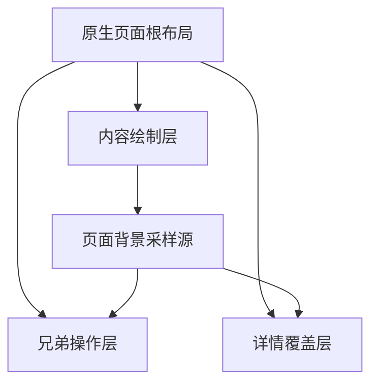

# STU 助手 UI 重构设计与实施准备

> 最新范围以 [Compose 原生重写 V1](Compose原生重写V1范围与实施顺序.md)为准：五导航为今天／课表／事项／校园／我的，事项合并个人计划与学校作业并保留考试/成绩，其余页面先按现 JS 功能等价迁移。本文早先三导航、学业重新归类和大幅布局调整属于研究历史，不再作为首版实施或重复确认的前置条件；圆角、材质、可读性、状态与触感原则继续沿用。当前 GPU 验证包已经完成，旧环境与“尚无 Compose”的表格仅为准备时基线。

日期：2026-10-30  
适用对象：产品设计、Android 开发、Web 维护和验收人员  
准备基线：`main`，`d2a343e1bd3c065fb110529cc52f4c77b3112a24`  
当前产品版本：`1.0.31`，`versionCode 32`

当前状态：方案讨论中，暂不开始编码。环境与旧版测试基线已经准备，信息架构、页面结构和主要交互仍需讲清并由用户确认；本文件不是启动实现的授权。

本次改造围绕课程、个人事项和校园信息，重新设计任务路径、信息密度、展示形式和交互反馈，再建立视觉系统。优先用图形、位置、长度、状态与直接操作传达信息，减少常驻说明文字。Android 原生样板采用 Kotlin 和 Jetpack Compose，评估 Kyant0 Backdrop 与 Shapes；现有 FastAPI 和 STU-MCP 继续承担认证、采集与同步，React 网页继续维护。先验证少量完整页面，再分阶段迁移 Android 主流程。

本文件整合 AndroidLiquidGlass、LastWave-native、Telegram、Apple 圆角规则和曲线感知研究，给出编码范围、初始设计规范、迁移约束及验收条件。本文中的“已确定”来自用户要求或当前代码事实；“初始方案”是可执行的设计起点，仍可通过原型调整。

本轮新增准备文档，在 `DESIGN.md` 添加入口，执行基线检查并并行补齐所需 SDK 工具。原生工程、产品页面、业务接口和现有构建配置尚未修改；没有生成发布包、提交 PR 或发布线上版本。

## 1 目标和范围

### 1.1 已确定的要求

- UI、导航、手势、动效和触觉作为一个系统设计，保持校园工具的信息效率。
- 现有交互路径、功能分组、信息密度和展示形式都重新审视；旧页面结构仅作能力清单与对照基线。
- 能以图形、布局和状态清楚表达的信息优先视觉化，删除多余文字；不以小字体说明功能，也不通过缩小字体和触控区域提高密度。
- 重点参考 AndroidLiquidGlass，同时参考 LastWave-native 的完整应用整合方式。
- 圆角是核心设计内容，包含连续曲率、嵌套关系、尺寸适配和光学校正，重点吸收 Apple iOS 的设计思路。
- 延续指定会话 `01a187f0-ab26-7bb3-ac84-31b27db9b210` 的要求：参考项目时讲清真实技术栈和实现差异。
- 延续已选定的两段按键触感和唯一的 0–100 强度设置，不恢复旧调试台。
- 底部导航需要减少选项，不能沿用现有六项结构；当前推荐三项方案，尚待用户确认。
- 当前阶段继续完善方案，未讲清重构并获得用户明确开始指令前，不创建新客户端工程或修改业务代码。

### 1.2 改造要改善的任务

1. 打开首页，立即找到当前或下一节课、教室和时间。
2. 区分最近截止的学校作业与自己的个人计划。
3. 查看一周课程分布、当天空档、调课和未排定内容。
4. 在校园通知中快速搜索并辨认来源、时间和链接。
5. 切页、开详情、返回时保持上下文，操作与反馈一致。

效率通过任务完成时间、成功率和误触衡量；审美通过同一内容、同一尺寸下的对照评估。两类结果分别记录。

### 1.3 业务边界

继续保持学校系统只读，不新增签到、提交作业、缴费和其他代办能力。个人计划 CRUD 属于助手自己的数据，与学校只读数据分开处理。业务边界详见[授权与边界](授权与边界.md)。

此次不重写学校协议、不升级 STU-MCP、不调整服务端密码保存策略、不改发布通道。新增原生客户端通过现有 HTTP 接口访问后端，学校系统接入继续归属 STU-MCP 与现有服务端编排。

## 2 当前基线

### 2.1 已有能力

| 范围 | 当前事实 | 依据 |
| --- | --- | --- |
| 客户端 | React 19、TypeScript、Motion 12、Vite、Capacitor 8.5.3 | [package.json](../web/package.json) |
| Android | Java BridgeActivity 和原生插件；尚无 Compose 页面 | [Android 工程](../web/android/app/build.gradle) |
| SDK 与构建 | minSdk 24、compileSdk 36、targetSdk 36；AGP 8.13.0、Gradle 8.14.3 | [SDK](../web/android/variables.gradle)、[AGP](../web/android/build.gradle)、[wrapper](../web/android/gradle/wrapper/gradle-wrapper.properties) |
| 主导航 | 今天、计划、课表、学业、校园、我的，共六项 | [TabBar.tsx](../web/src/components/TabBar.tsx) |
| 设计基础 | 两套色系、浅深主题、字体与间距令牌、弹簧档位、磨砂底栏、安全区 | [tokens.css](../web/src/styles/tokens.css)、[motion.ts](../web/src/lib/motion.ts) |
| 页面状态 | 预览、真实数据、缓存、加载、同步、来源过期与重连 | [store.tsx](../web/src/lib/store.tsx) |
| 详情交互 | 弹层、焦点归还、返回键优先关闭、滚动锁定 | [Sheet.tsx](../web/src/components/Sheet.tsx) |
| 触觉 | 原生 RichTap 与兼容路径、强度保存、取消和调度 | [按键触感](按键触感.md) |

`DESIGN.md` 的五项导航描述属于旧设计记录，当前代码为六项。已有文档中的历史审计成绩与截图不能直接代表本次重构的验收结果。

### 2.2 当前需要优先改善的地方

- 今天页尚未把个人计划纳入当天事项，课程、计划和作业的使用路径分散。
- 六项底栏在窄屏上较紧，浮动化后必须重新核对标签和触控区域。
- 常规信息容器和可操作卡片的按压表现需要区分，避免静态区域暗示可点击。
- 首页随机开场、扫光及课表呼吸效果与新的玻璃材质需要统一取舍。
- 通知页冷知识位于搜索和通知主体前，应降低其首屏优先级。
- 主标签切换会滚回顶部；新方案应保存页面的列表位置、筛选和子视图。
- Web 色系与原生系统区底色的同步需要统一，避免只同步深浅模式。

## 3 参考项目的分工

| 参考 | 吸收的内容 | 应用到本项目 |
| --- | --- | --- |
| [AndroidLiquidGlass](https://github.com/Kyant0/AndroidLiquidGlass) | Backdrop 背景采样、模糊、透镜折射、交互形变 | 原生操作层和通用控件的材质实现 |
| [LastWave-native](https://github.com/Clash-Projects/LastWave-Native/tree/000c63b31651a02037d8e2d15406d5d29a2d872f) | Compose 主界面、浮动导航、持续状态入口、共享材质和主题 | 页面与材质的整合、导航状态协调、设置分组 |
| [Telegram Android](https://github.com/DrKLO/Telegram) | 列表节奏、搜索入口、工具栏和返回路径 | 通知、任务和来源管理的信息组织 |
| [Apple 设计系统](https://developer.apple.com/videos/play/wwdc2025/356/) | 连续圆角、fixed／capsule／concentric、容器关系 | 统一形状和嵌套规则 |
| [Figma 工程分析](https://www.figma.com/blog/desperately-seeking-squircles/) | 曲率、平滑量与可用边长之间的约束 | 设计参数与代码路径的一致性检查 |

LastWave 的固定研究快照使用 Backdrop `2.0.1` 和 Shapes `1.2.1`。其历史迁移文档覆盖范围大于当前部分实现；当前材质入口主要开放给导航、播放器、浮动控件和头部，不能据此认定所有卡片与弹层都实时折射。[依赖定义](https://github.com/Clash-Projects/LastWave-Native/blob/000c63b31651a02037d8e2d15406d5d29a2d872f/gradle/libs.versions.toml)、[当前材质范围](https://github.com/Clash-Projects/LastWave-Native/blob/000c63b31651a02037d8e2d15406d5d29a2d872f/app/src/main/java/com/lastwave/app/ui/theme/LiquidGlass.kt#L745)

材质和形状依赖优先直接使用其上游库。LastWave 作为设计和集成参考，其仓库许可证为 GPLv3；若后续需要复制代码，应先核对与本项目 MIT 分发方式的关系。Backdrop 与 Shapes 使用 Apache 2.0，实际引入时保留对应许可和来源记录。[LastWave 许可](https://github.com/Clash-Projects/LastWave-Native/blob/000c63b31651a02037d8e2d15406d5d29a2d872f/LICENSE)、[Shapes 许可](https://github.com/Kyant0/Shapes/blob/032af02e0ee88bd050d77997f25dd8adc2c49e1d/LICENSE)、[Backdrop 许可](https://github.com/Kyant0/AndroidLiquidGlass/blob/kmp/LICENSE)

## 4 页面和信息架构

### 4.1 首批设计范围

先完成三项主导航的信息结构和可交互结构草案，再制作日程的今天／一周、学业、校园通知及个人中心的关键状态。现有今天、计划、课表等页面作为能力对照，不直接照搬到新客户端。视觉和主要任务路径讲清后，再讨论原生样板的实现范围。

| 页面 | 主要组织方式 | 关键状态 |
| --- | --- | --- |
| 今天 | 日期与周次、当前或下一节课、临近事项、当天安排 | 上课中、待上课、无课、假期、首次同步、旧缓存、重连 |
| 课表 | 周次工具条、真实分钟光谱、选中日列表、详情 | 本周与其他周、空档、长课程名、跨教室、未排定、部分数据 |
| 通知 | 搜索、来源筛选、日期分组连续列表 | 有结果、无结果、加载、缓存、来源不可用 |
| 计划与学业 | 截止与日期优先，来源和操作能力清楚 | 个人完成、学校作业本机勾选、无截止、逾期、考试、成绩 |
| 我的 | 身份与来源状态、外观、单一触感滑条、隐私和依据 | 已连接、部分连接、过期、离线、强度关闭 |

今天页中“最近事项”可以汇合个人计划和学校作业，但每条保留来源与可操作范围。完成学校作业的本机标记不能展示为学校端已提交；已提交状态只在来源明确提供时显示。

### 4.2 推荐三项底部导航

推荐底栏从六项收敛到三项：**日程／学业／校园**。“今天”成为日程默认视图，“我的”改为所有主页面右上角的头像入口。新增计划、搜索与同步放在各自页面的操作区，不占底栏目的地。

| 主入口 | 用户来这里解决的问题 | 首屏与完整内容 |
| --- | --- | --- |
| 日程 | 接下来做什么、几点、在哪；这周怎么安排 | 默认今天；显式今天／一周切换；课程、空档与个人计划；相关学校截止节点 |
| 学业 | 学校布置了什么、何时考试、成绩如何 | 作业／考试／成绩三种视图；学校记录的完整清单与筛选 |
| 校园 | 学校有什么通知、需要什么校园服务 | 通知／生活／校历；搜索、来源、服务状态与官方入口 |

“今天”和“日程”不再作为同级入口，避免让用户在同一批时间信息的摘要和总览之间选择。三项是当前明确推荐，不是已获用户确认的最终方案；如果结构评审发现任务成本增加，再依据具体问题修正。

Apple 将底栏定位为稳定的顶层目的地导航，建议控制复杂度、避免溢出并保留短标签；Android 的导航栏适用于三到五个同等重要的目的地。这些规范支持缩减与稳定分组，并不证明三项在本项目已获得实测最优结果。[Apple Tab bars](https://developer.apple.com/design/human-interface-guidelines/tab-bars)、[Android Navigation bar](https://developer.android.com/develop/ui/compose/components/navigation-bar)

### 4.3 现有六项的完整去向

| 现有入口 | 新位置 | 保留的能力与边界 |
| --- | --- | --- |
| 今天 | 日程的今天视图 | 当前和下一节课、当天时间轴、空档与临近事项；新通知主清单归校园 |
| 计划 | 日程内个人计划 | 显式新增、选日、编辑、完成、排序和删除；不移入设置 |
| 课表 | 日程的一周视图和当天时间轴 | 换周、选日、空档、课程详情、未排定与冲突；来源和导入由日程的课表管理进入 |
| 学业 | 学业 | 作业、考试、成绩；作业本机完成与个人计划服务端状态仍独立 |
| 校园 | 校园 | 通知、生活、校历，保留原文外链和来源说明 |
| 我的 | 全局头像进入个人中心 | 账号、来源连接、外观、触感、更新、反馈、隐私、退出与删除 |

个人中心入口在三页同一位置，未登录时提供明确的连接／登录入口；来源失效也在相关内容旁提供重连动作。个人中心不承载难分类的学习功能。主页面底栏始终保持三个固定名称，不增加“更多”或无标签的第四项。

### 4.4 各页面内部结构

**日程**从今天打开。顶部显示日期、周次、全局头像，内容区有可见的今天／一周切换和新增计划动作。今天以一条时间轴组织当前课程、后续课程、有时间的个人计划；无时间计划放在当天待办区。一周显示真实时间尺度的课程分布，点一天在同屏查看完整安排，再点课程进入详情。课表管理位于日程工具区，缺数据时直接呈现连接或导入动作。

学校作业在日程中只投影为截止节点，完整清单与本机完成操作归学业；考试可投影为对应时段，点开仍是学业中的同一条考试记录。没有起止时间的作业不得画成虚构的两小时任务。今天、一周和学业中的同一实体使用同一 ID 与状态来源，不复制完成集合。

**学业**默认作业视图，顶部切换作业／考试／成绩。作业按截止组织，显示标题、短来源和截止值；考试显示日期、教室和座位；成绩显示分数、学分和必要估算标记。个人生活计划不放在这里，课表不再出现第二个同等入口。

**校园**默认通知视图，顶部切换通知／生活／校历。通知先显示搜索和来源筛选，正文使用紧凑连续列表。生活以图形状态配短名称展示图书馆、充电、交通和入口。校历承载完整日期规则，相关停课或重要节点只向日程投影。

**个人中心**从头像打开，返回恢复之前的主入口和状态。账号、连接来源、外观与触感使用清楚的设置分组；不在这里放日常查课、个人计划或成绩入口。退出、删除及来源授权保留明确文字。

### 4.5 主要任务的操作路径

| 任务 | 操作路径 | 结构要求 |
| --- | --- | --- |
| 看现在和下一节在哪上课 | 打开 App → 日程的今天 | 首屏能读到课程、时间和教室，不先选功能 |
| 找下周空档 | 日程 → 一周 → 切周／选日 | 选中日详情在同屏，完整课程可展开 |
| 记一条个人计划 | 日程 → 新增计划 → 保存 | 选中日期默认带入；有时间与无时间明确区分 |
| 找最近截止作业 | 学业 → 默认作业清单 | 日程截止节点可直接跳到对应作业，而不是重复建一份待办 |
| 查考试或成绩 | 学业 → 考试或成绩 | 显式切换，不藏在头像或更多菜单 |
| 找通知或空闲充电口 | 校园 → 通知或生活 | 各自只有一个主清单和状态来源 |
| 调触感或重新连接 | 全局头像 → 对应设置；来源错误也可就地重连 | 操作入口位置固定，保留已调校的触觉方案 |

### 4.6 返回和上下文恢复

冷启动默认日程的今天；会话内切主入口保留各自模式、日期、筛选和滚动。日程保存今天／一周模式、选周与选日；学业保存子视图与成绩学期；校园保存子视图、搜索与来源；个人计划保留正在查看的日期。详情返回恢复触发项，关闭个人中心恢复原主入口。返回优先关闭弹层，再回上级；离开主入口时回日程的今天，根页面再按平台约定离开 App。再次点击当前底栏项暂不新增回顶部动作。

LastWave 迷你播放器的持续状态模式可转译为“当前课程”入口，只在相关时段出现。先验证它与底栏、系统实况窗和键盘是否重复占位，不纳入首批必做功能。

## 5 信息表达与视觉规范

### 5.1 信息优先级和密度

每个页面先确定用户最需要作出的判断、主要动作和必要数据，再选择表达形式。首屏优先当前状态与下一步，详情承接低频信息；按需展开用于减少重复和次要内容，不把课程教室、截止时间、异常和主要动作藏进帮助。

密度以单位空间内可正确完成的判断衡量。通过整合重复标题、合并等义统计、统一列表节奏和按需展开提高密度；保留可读字号与触控空间。一个时段的课程、当前位置和进度尽量在同一时间结构中表达，避免用几张统计卡重复描述。

展示关系时优先选择对应的数据编码：时间用位置和长度，数量用可数单元或比例，完成用勾选和对象状态，选择用位置与形状变化，来源连接用状态符号与短标签。每个图形都要能追溯到真实字段和尺度：无时长事项不虚构持续时间，未获取数据不画为空闲或零值。

### 5.2 各页面的表达形式

以下按三项主入口内的内容视图列出，不再对应旧版六个独立页面。

| 页面 | 首选图形与布局 | 保留的关键文字和数值 | 主要交互 |
| --- | --- | --- | --- |
| 日程的今天 | 真实时间轴表达课程、当前时刻、空档和下一节点；课程进度嵌入对应时段 | 课程名、教室、起止时间、上课中或下一节、最近事项与截止 | 点课程展开同一对象；个人计划可直接完成；学校截止点跳对应作业 |
| 日程的一周 | 统一时间尺度的七日光谱、当前时间线、选中日、冲突重叠与空档 | 周次、日期、时间刻度；选中日完整课程名和教室；停课或未排定状态 | 可点的周次与日期；拖动为可选捷径，详情关闭回到原位置 |
| 日程的个人计划 | 选日与事项分布，有时间的计划进入时间轴，无时间事项列于当天待办；完成改变行状态 | 标题、日期、必要时间与个人标记 | 显式新增、编辑和勾选；服务端保存状态独立于学校作业 |
| 学业 | 作业按截止排列；考试用日期节点；可比成绩用简洁条形 | 作业标题、精确截止和学校来源；考试地点；分数、学分及估算标记 | 作业／考试／成绩显式切换；学校作业勾选只记本机 |
| 校园生活 | 图书馆开放时段条、充电端口阵列与占用比例、来源有依据的公交线路节点、校历日期轴 | 地点、开放状态、关闭时间、空闲与总数、采样时间；公交与充电的示意或实时状态 | 点状态查看位置或时间；服务入口保持短名称 |
| 通知 | 日期分组、固定来源位置与对齐标题；搜索筛选集中顶部；真实且有信息价值的附图才作缩略图 | 可读通知标题、来源、日期和原文动作 | 点标题打开原文；返回保持搜索、来源与位置 |
| 个人中心 | 主题使用小预览，来源用紧凑状态清单，触感用单一滑条与当前值 | 来源名称、已连接或需重连；浅色或深色；触感数值；退出和删除动作 | 从全局头像进入；直接选择主题、连接来源、调整强度；0 关闭触感 |

图形服务于任务理解，不增加装饰图表、虚构地图、电费仪表或无依据的公交到站预测。紧凑总览可以只展示分布，选中后的同屏区域承接完整名称，避免在每个微小色块内塞文字。

### 5.3 文字和图标的规则

- 默认工作界面不放常驻功能教学段落。删除“这里可以……”“点击上方即可……”等重复说明，功能通过清楚的控件、状态和直接操作表达。
- 课程名、通知标题、教室、精确时间、来源、示例或缓存状态，以及主要动作使用可读短文字；这些内容不靠用户猜图标。
- 错误与空态使用一个短状态和必要动作，例如“尚未同步／同步”“需重连／连接”。详细原因与依据进入用户主动打开的详情；影响判断的异常仍在当前页面可见。
- 非通用图标保留简短可见标签；主导航保留名称。图标统一尺寸、线重和语义，避免同一符号在不同页面代表不同动作。
- 图形和图标提供语义标签与读屏描述，文字保持可选择、可放大，不把信息烘焙成图片。
- 若去掉解释后操作难以理解，优先改控件、布局和动作路径，不将解释缩成页脚小字。

图标规则参考 Apple 关于简洁、可识别、语义一致和替代文本的指导；具体图标仍使用适合 Android 的资源与操作习惯。[Apple Icons](https://developer.apple.com/design/human-interface-guidelines/icons)

### 5.4 视觉方向

延续 S 标识，使用低饱和背景、清楚的中文排版和少量状态色。默认樱粉与经典海蓝先作为现有品牌基础保留，样板比较它们在玻璃材质下的可读性后，再冻结最终颜色值。

主强调色负责操作与选中；紧急色负责当前时间、临近截止与异常。课程颜色在同一门课程和不同视图中保持映射，颜色同时配合文字或标记表达状态。

内容层以稳定实底、连续列表和轻分隔为主；可操作对象、当前课程和浮层才使用明确容器。字号、对比和信息顺序先保证课程、教室、截止时间容易扫描。

### 5.5 初始排版参数

以下是样板起点，不是 Apple 固定参数。Android 使用 dp／sp；Web 对应 CSS 布局单位，不能用设备物理像素直接换算。

| 项目 | 初始范围 | 使用规则 |
| --- | --- | --- |
| 基础间距 | 4、8、12、16、20、24、32 dp | 以内容分组选择，避免页面各自随意叠加 |
| 手机横向边距 | 16–20 dp | 在 360 dp 宽屏与文字放大下复核 |
| 列表正文 | 16 sp 起点 | 多行中文标题保留稳定行距，按字体和任务校正 |
| 次级标签与数值 | 14–16 sp 起点 | 来源和时间保持清晰；功能解释直接移除，不缩成小字 |
| 页面标题 | 24–30 sp | 不挤占工具界面的操作区域 |
| 关键课程名 | 24–32 sp | 长标题允许换行，先保证教室与时间可见 |
| Android 触控区域 | 至少 48 × 48 dp | 视觉图标可更小，邻接触控区域不得重叠 |

数字、时间、倒计时使用稳定的数字宽度；中文优先系统字体。浅深主题、色系、状态栏图标和窗口底色由同一套主题状态驱动。

## 6 圆角和形状规范

### 6.1 曲线类型

圆角模型同时包含曲线类型、尺寸、各角配置与容器关系。普通四分之一圆和连续曲率圆角分别处理；Apple 的 `.continuous` 不能直接等同于某个固定指数超椭圆，也不能把社区拟合称为 Apple 原始算法。[Apple continuous](https://developer.apple.com/documentation/swiftui/roundedcornerstyle/continuous)

Android 优先评估 [Kyant0 Shapes](https://github.com/Kyant0/Shapes/tree/032af02e0ee88bd050d77997f25dd8adc2c49e1d) 的连续圆角。其官方介绍提供 G2 连续形状；形状实际输出、Backdrop 的透镜边界和轮廓类型必须在同一依赖组合下验证。[Backdrop 圆角教程](https://kyant.gitbook.io/backdrop/tutorials/smoother-rounded-corners)

Web 可保留普通圆角作为兼容基础，再评估 `corner-shape` 的渐进增强。其超椭圆参数是 CSS 规范自己的定义，与 Apple 连续圆角参数不能互换；必须对实际浏览器和 WebView 使用支持检测。[CSS 规范](https://www.w3.org/TR/css-borders-4/#corner-shaping)

### 6.2 按角色定义形状

| 角色 | 初始圆角 | 曲线与限制 |
| --- | --- | --- |
| 小型课表块、紧凑状态区域 | 8–12 dp | 适度圆润，保留长度和边界辨识度 |
| 输入与普通控件 | 12–16 dp | 连续圆角；焦点和错误描边沿同一轮廓 |
| 内容分组与当前课程面板 | 20–28 dp | 连续圆角；按内容密度和内边距校正 |
| 大详情弹层 | 28–32 dp 起点 | 结合窗口和各角位置计算，不强迫所有角同值 |
| 底栏与短胶囊控件 | 短边的一半作为尺度起点 | 使用专门 Capsule 形状，尺寸变化时重新求解 |
| 容器内的嵌套控件 | 由父容器和 inset 派生 | 不独立复制父圆角数值 |

半径必须按宽高限制，变化期间不能让相邻角重叠。平滑过渡所占的边长也要计算，避免短按钮被过度平滑挤压。固定半径、胶囊和容器派生是三个语义类型，不以一个全局大半径代替。

### 6.3 嵌套和边界

等距嵌套的基础关系为 `R_inner ≈ max(0, R_outer − inset)`。例如外层 28 dp、间距 12 dp，可从内层 16 dp 开始。圆弧在相应条件下可以严格同心；连续曲线和非均匀 inset 应以实际轮廓内缩与光学校正为准。[Apple 同心布局](https://developer.apple.com/videos/play/wwdc2025/356/)、[ConcentricRectangle](https://developer.apple.com/documentation/swiftui/concentricrectangle)

- 裁剪、背景、描边、焦点、阴影、触摸反馈与玻璃边缘使用同一个形状定义作为依据。
- 描边内外沿根据实际边界计算，避免单纯缩小图形造成厚度不匀。
- 图像裁剪遵守所在容器的内轮廓；圆角不能裁掉课程文字、输入光标和重要状态。
- 按压、展开与形状过渡可被新操作打断，保持轮廓连续，避免结束时切换到另一套圆角。
- 视觉圆角与有效触控范围分开定义，小控件依然预留足够触控空间。

### 6.4 学术依据的用途

| 研究 | 支持的结论 | 对本项目的用途 |
| --- | --- | --- |
| [Bar 与 Neta 2006](https://pubmed.ncbi.nlm.nih.gov/16913943/) | 轮廓影响快速偏好判断 | 重视第一印象，不由此推导最佳半径 |
| [Bertamini 等 2016](https://bpspsychub.onlinelibrary.wiley.com/doi/10.1111/bjop.12132) | 曲线偏好不能完全由尖角威胁解释 | 避免将曲线偏好简化为单一心理原因 |
| [Chuquichambi 等 2022](https://nyaspubs.onlinelibrary.wiley.com/doi/full/10.1111/nyas.14919) | 元分析支持总体曲线偏好，并存在任务与经验等调节因素 | 将审美偏好与校园任务效率分开验收 |

这些论文没有给出本项目应选的 dp 数值，也没有直接证明 G2 曲线优于圆弧的手机操作效率。具体半径、密度和效率由样板验证。

## 7 玻璃材质和渲染

### 7.1 材质层次

| 层 | 初始处理 | 适用位置 |
| --- | --- | --- |
| 内容 | 稳定实底或轻表面色 | 课表、通知、作业、成绩正文 |
| 操作 | 主题遮罩、受控模糊、轻折射与按压变化 | 底栏、周次工具条、分段器、少量浮动操作 |
| 详情 | 清楚的外轮廓与正文底色，局部材质 | 课程详情、筛选、计划输入 |

以低饱和遮罩和柔和深度为主，不给每张卡片描亮边或叠色散。折射、模糊和透明度按组件角色集中定义，参数先在真实内容背景上调校，再固化为令牌。

### 7.2 背景采样的归属



箭头表示操作层消费内容采样。详情层需要独立的合成关系时单独定义来源。任何玻璃表面都不得回到自己的采样链中；列表项不各自创建背景捕获源。主内容与控件处于同一 Compose 渲染体系，避免把最终方案做成原生玻璃覆盖旧 WebView。

Backdrop 文档规定 Android 12 起支持 RenderEffect，部分 RuntimeShader 和 lens 效果需要 Android 13 起。低版本、软件渲染、低性能或用户关闭透明效果时使用稳定表面。[Backdrop 效果说明](https://kyant.gitbook.io/backdrop/api/backdrop-effects)

样板开始时按能力划分三档：基础实底、模糊加遮罩、完整透镜。能力检测和运行验证共同决定档位，不能只按手机型号或 Android 主版本判断。原有 Android 7 安装下限作为兼容目标保留，是否需要调整由依赖实测后单列决定。

## 8 交互状态动效和触觉

### 8.1 动作和状态设计

先定义对象可以做什么、如何发现入口、操作如何取消、结果如何返回，再定义动画和震动。常用操作直接可见；滑动、长按和拖拽可加速操作，重要任务同时提供可见按钮或等价输入。手势不与系统返回和滚动冲突。[Apple Gestures](https://developer.apple.com/design/human-interface-guidelines/gestures)

交互至少区分空闲、按下、拖动或取消、确认、等待结果、成功与失败。点击已确认和服务端已保存是不同状态，界面必须分别表达。

| 交互阶段 | 视觉与对象状态 | 触觉与动作约束 |
| --- | --- | --- |
| 按下可用对象 | 即时按压、亮度或形状反馈，内容不等待动画才响应 | 调用已批准的按下反馈；不以渲染或轮询触发 |
| 释放并确认 | 立即选中、打开或进入提交状态 | 使用已批准的确认反馈与调度；触觉间隔不延迟业务动作 |
| 拖动或滚动取消 | 对象回到可理解的原状态，保留滚动惯性 | 取消待播事件；不补播点击确认 |
| 选择日期或分段 | 选中位置、内容与焦点保持一致 | 语义变化对应一次选择反馈，重复选中不连震 |
| 等待服务端结果 | 控件显示忙碌或待确认状态，防重复提交 | 不因等待循环震动；不把按键回弹当成保存成功 |
| 成功或失败 | 成功有稳定视觉结果；失败保留输入并给短状态和恢复动作 | 新结果类触觉先与触感方案统一，未批准前不另造震动模式 |

同一动作由一个反馈策略负责，避免全局监听与组件局部回调各播一次。触感关闭、设备不支持或减少动态时，状态和任务结果依然清楚。

### 8.2 统一交互节奏

- 按下立即改变视觉状态；业务动作不等待弹簧或触觉播放完成。
- 页面与底栏切换协同，点击和拖动不会反复触发互相竞争的选中动画。
- 课程详情、筛选和计划输入使用一致的展开、关闭与返回逻辑。
- 滚动时只保留必要反馈；常驻扫光、随机长开场和无限呼吸从主工作流中收敛。
- 减少动态时关闭装饰与明显形变；减少透明度是独立外观选项，保留文本和操作层级。

初始节奏：按压 80–120 ms、页面过渡 180–280 ms、弹层 240–360 ms。弹簧以响应和阻尼调节，可被打断；这些时间是样板调校范围，不构成固定播放等待。

### 8.3 当前触觉基线

| 项目 | 规范 |
| --- | --- |
| 默认强度 | 100 |
| 按下 | 短促脉冲，强度 100，相对锐度 52 |
| 点击确认 | 短促脉冲，强度 100，相对锐度 100 |
| 快速点按两段起点间隔 | 至少 110 ms |
| 用户设置 | 仅 0–100 强度，0 完全关闭；本机持久化 |
| 滑条 | 保留现有选择反馈与限频，不排队补播 |

110 ms 是两段触觉起点的最短间隔，不是界面点击延迟。长按后确认可立即播放第二段；滚动取消、失焦、后台和关闭反馈时清掉待播放事件。锐度是厂商相对参数，不标为 Hz。

提取现有 `RichTapPattern`、`HapticTiming` 和 `RichTapHaptics` 为原生能力层，替换 Capacitor 调用包装，保留兼容设备回退。请求被接受只说明调用结果，实际手感仍由实体设备确认。细节以[按键触感](按键触感.md)及现有单元测试为准。

### 8.4 与触感工作协同

触感属于统一交互设计。另一会话负责的马达调校成果由本方案消费；本轮不改强度、锐度、调度和兼容路径，不维护第二套手感参数。进入编码前重新读取最新触感文档与已合入实现，若基线更新，先同步本节再验证新控件。

每个控件一起评审可发现性、命中范围、按压形变、释放确认、状态转移、取消条件和触感。视觉与触觉表达同一动作的因果关系，触感作为可关闭的补充通道，不独自承担重要提示。[Apple Playing haptics](https://developer.apple.com/design/human-interface-guidelines/playing-haptics)

## 9 原生客户端架构

### 9.1 工程边界

初始方案在仓库新增独立 `android-native/`，使用独立 Gradle wrapper 和版本目录。现有 `web/android/` 保留原构建，不在样板阶段批量升级其工具链。

样板使用独立测试 applicationId，例如 `com.stuassistant.app.nativepreview`，与正式版和触觉测试版并存。原型不自动读取或覆盖既有 WebView 数据。最终包名、签名、版本升级和数据迁移在替换现有 Android 客户端前确定。

```text
android-native/
  app/                         Compose 入口与导航
  core/design/                 颜色 字体 间距 形状 材质 动效
  core/model/                  客户端领域模型
  core/data/                   HTTP Repository 缓存 来源状态
  core/platform/               触觉 系统区 通知与生命周期
  feature/today/               今天
  feature/timetable/           课表与课程详情
  feature/campus/              通知与校园
```

这是目录边界，初期可使用一个 app module 下的 package，不要求一次拆出大量 Gradle module。导航统一管理返回栈；页面 ViewModel 通过 StateFlow 暴露 UI 状态；Repository 负责请求和缓存，不让 Composable 直接处理登录与同步协议。

### 9.2 复用与迁移

| 部分 | 处理方式 |
| --- | --- |
| FastAPI 和 STU-MCP | 继续复用，客户端不复制学校协议 |
| `/v1` 请求与错误契约 | 按当前后端和前端实现复核后建立原生模型 |
| 学期与时间规则 | 迁移 TS 中已定义的行为，用同一 fixture 对照 Kotlin 结果 |
| 课程合并与安排 ID | 保留节次、教室、周次与学期边界，避免视觉分组改变数据身份 |
| 个人计划 | 复用现有端点；原生端对创建等非幂等请求显式采用不自动重放策略 |
| RichTap 引擎 | 复用 Java 核心，入口改为原生生命周期和交互事件 |
| 实况窗与通知 | 提取 Android 平台实现，后续阶段接入 |
| React 页面和 CSS | 留给 Web；Android 对应页面使用 Compose 实现 |

### 9.3 状态和数据要求

1. 区分预览、真实、缓存、加载、同步、部分成功、需重连、空数据和不可用状态。
2. 医学院或手动导入的真课表不得被示例数据覆盖；无成绩和无作业不能伪造完整来源。
3. 来源新鲜度分来源表达，只有通知更新不能让旧课表或作业显示“刚更新”。
4. 旧账号迟到响应不得写入新账号缓存，旧 token 的 401 不得注销新登录。
5. 计划创建、导入等非幂等动作不在网络失败后盲目重试；防重复提交与按钮忙碌态明确。
6. 学校日程按 `Asia/Shanghai` 业务时间解释；设备所在时区不改变课表周次和截止语义。带偏移时间保留偏移解析。
7. 部分解析失败保留旧缓存和范围提示；未经来源确认的删除和提交状态不推断。
8. 输入凭据、学校验证码和来源授权继续使用既有业务规则，不随 UI 重构扩展权限。

初期样板使用合成或已脱敏预览数据。最终原生客户端的 token、服务器地址、偏好和账号分区缓存需要明确迁移或重新登录方案；DataStore 用于偏好，不默认等同于敏感数据加密存储。

当前学校数据缓存与个人计划存储是两条链路：学校数据由 Store 管理；个人计划通过 `planApi` 保存到服务端，当前没有离线写入队列或个人计划离线缓存。新界面不能承诺断网仍可编辑计划。学校作业本机完成标记与个人计划服务端完成状态使用独立标识和存储，学校同步不得覆盖个人计划。

当前 Web 的 `plan-api.ts` 未显式禁用共享请求层的默认重试，计划创建在网络失败后仍有重放风险；现有单测明确覆盖的是导入请求的单次行为。此项登记为原生迁移的契约强化点，Web 修复单独跟踪，本轮未改业务代码。[计划请求](../web/src/lib/plan-api.ts)、[共享请求](../web/src/lib/http.ts)、[请求回归测试](../web/tests/http.test.cjs)

保留上下文是本次要新增的行为：当前页面卸载会丢失局部选择，不能将它写成已通过的基线。Android 返回栈与浏览器 history 分开定义；现有 Web 页面没有完整 history 路由，新原生导航不照搬浏览器事件模拟。

## 10 依赖和环境准备

### 10.1 依赖选择原则

候选为 Backdrop `2.0.1`、Shapes `1.2.1`。这是固定候选组合，不使用动态 `+` 版本。首次原生提交前核对 Maven 元数据、Android AAR 要求、Compose 和 Kotlin 编译插件配套关系、AGP 与 Gradle 支持范围，再提交版本目录与解析结果。

本次已读取发布实物：

| 发布包 | 实物要求或依赖 |
| --- | --- |
| `backdrop-android:2.0.1` | AAR metadata 声明 `minCompileSdk=37` |
| `shapes-android:1.2.1` | AAR metadata 声明 `minCompileSdk=37` |
| 两者 POM | 发布依赖包含 Kotlin `2.4.10`、JetBrains Compose `1.12.0` |
| AndroidX Compose UI／Foundation `1.12.0` | AAR metadata 声明 `minCompileSdk=37`、`minAndroidGradlePluginVersion=9.1.0` |

实物来源：[Backdrop AAR](https://repo.maven.apache.org/maven2/io/github/kyant0/backdrop-android/2.0.1/backdrop-android-2.0.1.aar)、[Shapes AAR](https://repo.maven.apache.org/maven2/io/github/kyant0/shapes-android/1.2.1/shapes-android-1.2.1.aar)、[Backdrop POM](https://repo.maven.apache.org/maven2/io/github/kyant0/backdrop-android/2.0.1/backdrop-android-2.0.1.pom)、[Compose UI AAR](https://dl.google.com/dl/android/maven2/androidx/compose/ui/ui-android/1.12.0/ui-android-1.12.0.aar)。

因此现有 SDK 36／AGP 8.13 不能原样消费该候选组合。独立工程优先评估以下工具链，而不是在原 Capacitor 工程内整体升级：

| 项目 | 原生样板候选 | 状态 |
| --- | --- | --- |
| AGP | `9.1.1` | 高于依赖最低要求，待首次工程编译 |
| Gradle | `9.3.1` | 按 AGP 9.1 兼容要求选择，待独立 wrapper 验证 |
| Kotlin 与 Compose compiler | `2.4.21` | 按 Kotlin 官方兼容矩阵选取候选，待编译验证 |
| Compose UI | `1.12.0` 对应依赖线 | 待解析确认 Android 消费端构件和版本一致 |
| compileSdk | `37` | 发布实物要求 |
| Build Tools | `36.0.0` 起 | 按 AGP 工具要求核对 |
| minSdk／targetSdk | 以当前 `24／36` 为起点 | 首次构建验证，不将 compileSdk 要求误当安装下限 |
| JDK | 使用现有 JDK 21 | 独立 wrapper 验证 |

AGP 9 默认内置 Kotlin，首次工程配置需核实实际 Kotlin 编译器与 Compose compiler 的配套关系，不重复套用旧式 Kotlin Android 插件。POM 中的 Kotlin stdlib 版本是发布依赖，并不要求消费端编译器必须固定为同一版本。[Kotlin 兼容矩阵](https://kotlinlang.org/docs/gradle-configure-project.html)、[AGP 9.1](https://developer.android.com/build/releases/agp-9-1-0-release-notes)

编译 SDK 要求、最低安装版本、目标 SDK 和设备 GPU 能力分别记录。LastWave 的工具链只作为线索，不能直接复制其整份 Gradle 配置。独立原生工程先解决自身依赖，现有 Capacitor 发布构建保持原配置。

### 10.2 本机准备记录

本节以此次实际环境检查结果为准；完整设备操作流程见[Android CLI 开发与验证](Android-CLI开发.md)。已有文档描述的历史构建不替代本次命令结果。

| 项目 | 此次检查结果 |
| --- | --- |
| Java | JDK 21.0.13，现有环境可运行旧工程 wrapper |
| Android CLI | `1.1.16717390`，已有安装，不升级 |
| 当前已安装平台 | 原 SDK 36 保留；已并行安装 `platforms;android-37.0`，revision 2 |
| Build Tools | 原 `35.0.0` 保留；已并行安装 `36.0.0` |
| 模拟器 | Android Emulator 37.2.13；已有 `Medium_Phone_API_37.0`，本轮未启动 |
| 已有 Gradle | 8.14.3 缓存用于旧工程；新工程 9.3.1 尚未初始化 |
| 旧原生单测 | 使用临时 ASCII 盘符、离线模式执行，8 项通过；没有修改 Gradle 文件 |

Windows 非 ASCII 路径下，单独跳过 AGP 路径检查不足以保证 JUnit 正常装载测试类。此次沿用本机脚本已有的临时 ASCII 映射方式获得有效测试结果，完成后清理本次创建的映射。后续可复用此策略或使用可靠的 ASCII 工作路径，不把启动失败计作断言通过。

SDK 安装已退出 0，并检查了两个新包的 `package.xml`、`source.properties`、SDK 37 的 `android.jar` 和 Build Tools 36 的 `aapt2.exe`。实际包 ID 为 `platforms;android-37.0`；首轮使用 `platforms;android-37` 未找到包，失败日志保留。安装没有出现新许可提示，没有自动接受新协议，也没有修改环境变量、代理、JDK、Android CLI 或现有模拟器。

## 11 迁移功能矩阵

| 能力 | 样板阶段 | 完整迁移阶段 | 主要依据 |
| --- | --- | --- | --- |
| 今天与课程详情 | 完整预览交互，再接课表和来源状态 | 接个人计划摘要及各类异常状态 | Today、CourseSheet、plan、timetable |
| 课表与日光谱 | 完整周切换与选中日联动 | 医学院、手动导入、未排定与学期边界 | Week、DayRibbon、calendar、sections |
| 通知搜索与筛选 | 设计稿，随后实现列表样板 | 来源、日期、搜索筛选、原文外链与返回 | Campus、records、api |
| 个人计划与学业 | 保留目的地与初始状态设计 | CRUD、作业本机标记、考试与成绩 | Plan、Study、plan-api |
| 登录与来源连接 | 使用预览数据，不阻塞视觉验证 | 登录、注册、验证码、重连、退出、清理 | Welcome、school、med-api、http |
| 导入课表 | 明确子页归属 | 文件输入、预览、校验与确认 | Import、timetable-import |
| 校园生活与校历 | 保留入口 | 充电、图书馆、公交和服务外链 | Campus、BusBoard、live、calendar |
| 外观与触觉 | 浅深、减少动态、材质降级、单滑条 | 色系、持久化、全部兼容路径 | useTheme、haptics、FeedbackSettings |
| 更新与实况窗 | 保留架构接口 | 当前发布与通知行为对齐 | version、UpdateBanner、native |

迁移检查需使用当前 API 与 fixture。`docs/phase0` 中的数据契约明确以 STU-MCP 0.7.3 为历史基线，不能据此覆盖当前已修复的解析和账号行为。

### 11.1 固定样例和复现入口

| 场景 | 可复用输入 | 确定性检查 |
| --- | --- | --- |
| 上课中 | `?preview=1&now=2026-10-28T10:20` | 生物统计学，10:00–12:35，桑浦山 E305；首页和详情一致 |
| 午间空档 | `?preview=1&now=2026-10-28T13:10` | 当前无课与后续晚课的表达正确 |
| 假日 | `?preview=1&now=2026-10-01T10:00` | 国庆停课状态，不显示普通上课倒计时 |
| 不同截止组 | `previewTasks()` | 逾期、今天、明天、三天后、较远日期与无截止 |
| 通知筛选 | `previewNotices()`；关键词“职业规划”“资助” | public／OA 来源及标题匹配正确 |
| 个人计划 | 演示后端的测试用户创建记录 | CRUD、持久化、失败恢复与跨用户隔离 |
| 数据和错误模型 | [phase0 fixtures](phase0/fixtures/) | 作为历史样本，结合当前 schema 和回归案例迁移 |

Web URL 用于旧版对照。原生预览以相同业务时间和数据建立显式 fixture，不依赖 WebView 执行这些 URL。旧版免登录预览中的计划页只有日期和登录提示；原生样板若增加内存演示计划，必须明确标注演示、不承诺服务端保存。

## 12 验收方法

### 12.1 任务对照

在相同数据、时间、屏幕尺寸与字体缩放下，对旧版和样板分别执行以下任务。首次探索与熟悉后的操作分开记录，不预先编造收益百分比。

| 编号 | 任务 | 记录与通过条件 |
| --- | --- | --- |
| U01 | 找到下一节课的教室和开始时间 | 完成时间、错误次数；结果与课表一致 |
| U02 | 找到最近截止作业 | 时间与来源正确；个人完成和学校提交不混淆 |
| U03 | 演示后端登录用户添加并完成个人计划 | 一次提交生成一条，失败可理解，完成后状态保存；免登录预览不承诺保存 |
| U04 | 换周查看某天最长空档 | 周次、日选择、真实分钟长度和详情一致 |
| U05 | 搜索并筛选通知，打开原文后返回 | 筛选、搜索词和列表位置保持；分别验收外链返回与内部导航 |
| U06 | 打开课程详情并用返回手势关闭 | 先关详情，焦点和原页面上下文恢复 |
| U07 | 调整触感并重启 | 单滑条保存，0 关闭，取消手势不补播 |
| U08 | 离线查看已缓存的学校数据并重连 | 缓存、新鲜度与来源状态不误导；个人计划不承诺离线写入 |

### 12.2 几何和可读性

- 对所有形状检查直边到转角、嵌套间距、描边厚度、内容裁剪、按压中间帧和大小变化。
- Android 以 360、390、430 dp 等窗口宽度检查，另测平板／分屏；Web 以对应 CSS 视口单独检查。
- 覆盖浅深主题、两套色系、系统字体放大和长中文标题；关键内容不依赖省略号读取。
- 正文对比至少 4.5∶1；符合大文本定义时至少 3∶1；玻璃须对实际合成背景核验。[WCAG](https://www.w3.org/WAI/WCAG22/Understanding/contrast-minimum.html)
- Android 可交互区域至少 48 dp；Web 维持已有 44 CSS px 审计门槛，按平台分别计量。[Android 触控规范](https://developer.android.com/develop/ui/compose/accessibility/api-defaults#minimum-target-sizes)
- TalkBack 验证名称、角色、选中、焦点顺序和弹层焦点；自定义形状不改变控件语义。
- 键盘打开后输入、提交和关闭按钮可达；底栏、弹层与系统手势区不重复让位。

### 12.3 性能和运行

性能在原生真机记录。60 Hz 的一帧约 16.7 ms，120 Hz 约 8.3 ms；以设备实际刷新率、帧时间分布和掉帧情况判断，不能由截图或源码注释宣称“120 Hz 流畅”。

测量冷启动、连续切页、通知长列表、周次切换、详情拖动、键盘和前后台恢复。对相同原生样板比较完整玻璃与降级表面，记录帧时间、慢帧、内存和空闲时是否持续重绘；与旧版做相同任务对照。温度、电量、刷新率和渲染档位随记录保存。

至少覆盖 Find X8 Pro 的真实触觉与材质表现、一个较低性能设备或对应能力档位、API 31–32 模糊路径、API 33 以上透镜路径和更低 API 的基础表面。模拟器用于功能与布局，不能替代马达和 GPU 真机结论。

### 12.4 测试工具的使用边界

现有 `audit.mjs` 检查部分 Web 视图的 axe、对比度、触控、溢出和 CLS；它未覆盖计划、导入、医学院连接、Welcome 和全部弹层，并使用禁用 GPU 的 headless Chrome。后续扩展覆盖时仍只用于 Web 侧，原生 Compose 另外编写语义与交互检查。

`e2e.mjs`、`e2e-native.mjs` 和 `check-haptics.mjs` 可作为原有行为参照，但其浏览器结果不替代原生客户端验收。基线通过的 HTTP 和 records 测试用于保留账号隔离、请求与截止字段语义。

### 12.5 信息表达和交互验收

1. 默认工作界面的常驻功能教学段落为零；必要状态、授权和错误信息仍清楚可见，低频帮助由用户主动打开。
2. 首次使用者无需事先讲解或隐藏手势，就能完成找课程教室、找截止事项、新增计划和打开通知等任务。
3. 同一任务对照中记录首屏可作出的判断、查找时间、错误、误触、详情打开次数和常驻文字量；减少文字后若理解错误或探索成本增加，需要重新调整表达。
4. 不进详情可读出当前或下一节课的名称、教室和时间；有近期事项时可找到最近截止及来源。图形能够正确表达何时有课、哪天空闲和是否冲突。
5. 不以缩小字体、触控区、关键标题或对比度换取密度；在 360 dp 窗口和字体放大下复核。
6. 灰度、减少动态、实底降级和触感关闭时，选中、完成、过期、冲突与来源状态仍可辨认；颜色之外保留位置、形状或短标签。
7. 每个图形能对应真实字段与尺度；未知、未接入、示例、空闲和零值分别表达，不用装饰进度或随机图表替代数据。
8. 录屏与触觉调用记录共同检查按下、释放、取消和结果。一次动作没有重复反馈，取消不补播，0 强度静音；提交成功由结果确认，按压回弹不提前宣称保存。

## 13 实施顺序和完成条件

| 阶段 | 工作范围 | 完成条件 |
| --- | --- | --- |
| P0 方案讨论与准备 | 固定基线，讲清三项导航、全部能力去向、各页结构、关键路径和状态 | 页面结构、表达形式和关键交互完成评审并获用户确认；当前仍在此阶段 |
| P1 独立原生样板 | 先完成任务流、信息组织和状态原型；锁定工具链；实现今天、课表与共用交互 | 可安装预览包；信息理解、关键任务、触觉、圆角和材质降级可检查 |
| P2 真实只读切片 | 接现有登录／课表／来源状态，加入通知搜索 | 真实与缓存状态正确，旧账号响应隔离，返回与列表状态保持 |
| P3 功能迁移 | 计划、学业、校园生活、导入、来源管理和更新 | 功能矩阵逐项对齐，Web 无回归 |
| P4 替换准备 | 数据迁移、包名签名、兼容设备、完整回归 | 升级和回退可验证，正式版本与发布通道一致 |

当前先完成任务路径与信息清单、三项导航结构、图形表达和密度草案、动作与状态规则；方案讲清并由用户明确指示开始后，才进入新工程、依赖验证、设计令牌及 shape、Backdrop 与控件实现。环境已准备不代表方案已完成，当前不并行启动工程骨架。

首个编码改动先建立独立工程、固定依赖和预览入口，再加入形状与材质样例；通过构建后继续页面实现。编码前复核当前 HEAD 与工作区，使用 `codex/` 前缀开发分支，保留原有未跟踪内容。当前 main 未因本轮准备工作切换分支。

首批对照截图使用第 11.1 节固定时间和数据，分别记录旧版与样板，覆盖浅深主题和窄屏。旧版随机开场需等待结束或在减少动态模式下取稳定帧；动效另用连续录制观察，不把随机中间帧当布局差异。截图前缀与输出目录单独设置，避免现有截图脚本清理原有资料。

每个阶段形成独立、可运行、可审阅的改动；首个 PR 不包含所有页面重写和服务端改造。APK、密钥、本机 SDK、抓取日志与真实账号数据不进入 PR。发布行为继续走现有项目流程。

### 13.1 编码前检查单

下列已完成项表示研究或环境工作完成，不表示允许开始编码。

- [x] 汇总本聊天和指定会话的设计要求，明确继续保持业务边界。
- [x] 固定本地 `main` 与版本，记录原有未跟踪文档。
- [x] 核对 React／Capacitor 与原生 Compose 的差异，划分复用边界。
- [x] 确定首批页面、状态矩阵、圆角和玻璃材质的初始规则。
- [x] 明确信息图形化、文字精简、密度和交互重构要求，并将触感纳入同一套动作规范。
- [x] 记录候选依赖、参考快照和源码许可证。
- [x] 执行现有前端测试与类型检查。
- [x] 执行旧 Android 单元测试，并行补齐 SDK 37 与 Build Tools 36，保留旧工具版本。
- [x] 明确原生样板的独立目录、测试包名和现有工程保留策略。
- [x] 整理真机、无障碍、状态与性能验收任务。

当前方案仍待完成的事项：

- [ ] 用户确认三项底栏、今天作为日程首页和头像个人中心的安排。
- [ ] 用结构草案讲清日程今天／一周、学业、校园和个人中心的第一屏及详情去向。
- [ ] 对查课、找作业、记计划和看通知逐步走查，核对功能未遗漏、状态未重复。
- [ ] 明确图形表达、信息密度与触觉反馈后，由用户指示开始编码。

进入 P1 后的验证事项：

- [ ] 固定原生工具链并完成实际依赖解析、最小 Compose 与 Backdrop 构建。
- [ ] 冻结今天、课表、通知三页的浅深视觉稿和关键状态。
- [ ] 完成图形表达与首次使用任务验证，检查无需小字教学仍能正确理解和操作。
- [ ] 用预览包检查连续圆角、同心内缩、遮罩和玻璃边缘是否协调。
- [ ] 完成原生手势、返回、键盘和触觉的首次设备验收。
- [ ] 获得玻璃与基础表面两档的性能数据，再冻结默认材质档位。

### 13.2 方案讨论的初始选择

| 选择 | 开始时使用的默认值 | 调整依据 |
| --- | --- | --- |
| 导航入口与分组 | 推荐日程／学业／校园三项；我的移全局头像 | 待用户确认，并走查关键任务与窄屏触控 |
| 默认色系 | 沿用现有樱粉，保留经典海蓝 | 浅深玻璃对照与用户反馈 |
| 当前课程常驻胶囊 | 首批不加入 | 是否帮助跨页查课、是否重复占位 |
| 旧登录态迁移 | 样板独立预览；真实切片先显式登录 | 正式升级前设计一次性迁移或重登 |
| 原生模块数量 | 单 app module 内按 package 划分 | 构建、复用和维护需求 |

这些默认值用于方案讨论，当前不作为启动原生实现的依据。

## 14 本次准备验证记录

| 检查 | 结果 |
| --- | --- |
| Git 基线 | `main`，`d2a343e1bd3c065fb110529cc52f4c77b3112a24` |
| 产品版本 | `1.0.31`，`versionCode 32`，Web 常量与 Android 配置一致 |
| 前端单元测试 | `cd web; npm test`，35／35 通过，退出码 0 |
| 前端类型检查 | `cd web; npm run typecheck`，通过，退出码 0 |
| 旧 Android 单元测试 | ASCII 路径下 `:app:testDebugUnitTest --offline --no-daemon --max-workers=2`，8 项通过，0 失败／错误／跳过 |
| 原生测试覆盖 | HapticTiming 4 项、RichTapPattern 3 项、ExampleUnitTest 1 项；不等于新页面或真实马达验收 |
| 原生测试证据 | 本机 `tmp/preflight-native-unit-tests-ascii.log` 与 `web/android/app/build/test-results/testDebugUnitTest/`；均为本地构建产物 |
| SDK 准备 | `platforms;android-37.0` revision 2、Build Tools `36.0.0` 安装并核验成功；原 SDK 36 和 Build Tools 35 保留 |
| SDK 安装证据 | 本机 `tmp/preflight-sdk37-dot0-buildtools36-install.log`；首次无效包 ID 日志 `tmp/preflight-sdk37-buildtools36-install.log` 保留 |
| 原有未跟踪内容 | `docs/Android-CLI开发.md`，本轮保留原样 |
| 本轮产品改动 | 无业务代码和构建配置改动；新增本文件，在 `DESIGN.md` 添加入口 |
| 尚未运行 | 新原生客户端构建、原生页面任务、玻璃性能和新视觉真机验收 |

当前结论为环境与旧工程基线准备完成，重构方案尚未冻结，暂不进入 P1 编码。先把三项导航、各页结构和关键交互讲清；后续实现仍需通过 P1–P4 的设计、运行、功能和升级验收。

## 后续授权：原生底栏先行验证（2026-10-30）

用户随后明确授权先替换当前六项底部导航、采用原生 Compose、按 Kyant 源码移植并交付 APK。该局部验证已完成，版本为 `1.0.31-glass.2`；旧底栏在原生挂载成功后从 React 树移除，底栏改为单次选中触感，普通按钮保留两段反馈。已修复原生内部 View 继承纯色背景导致遮挡页面的问题。

具体来源、工具链、适配和实际验证记录见 [原生液态玻璃底栏实现说明](原生液态玻璃底栏实现说明.md)。上述表格保留为改动前基线记录；这次局部落地不等于全客户端或本文件提出的信息架构重构已完成。

用户进一步要求保留业务 WebView，移除截图桥验证原项目的实时折射。当前 `1.0.31-gpu.1` 已将同一 WebView 接入 `AndroidView + LayerBackdrop`，不再使用 Bitmap 定时采样。连续 CSS 动画、空闲、输入法、旋转和后台恢复的实际证据与性能限制见 [WebView 实时 GPU 液态玻璃验证](WebView实时GPU液态玻璃验证.md)。
