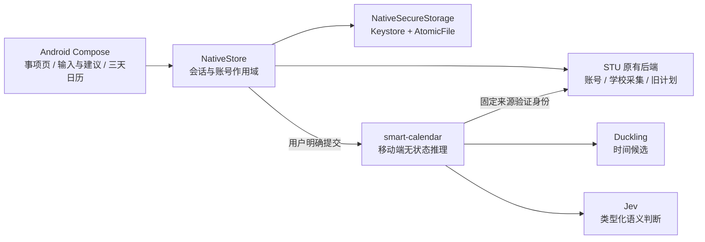
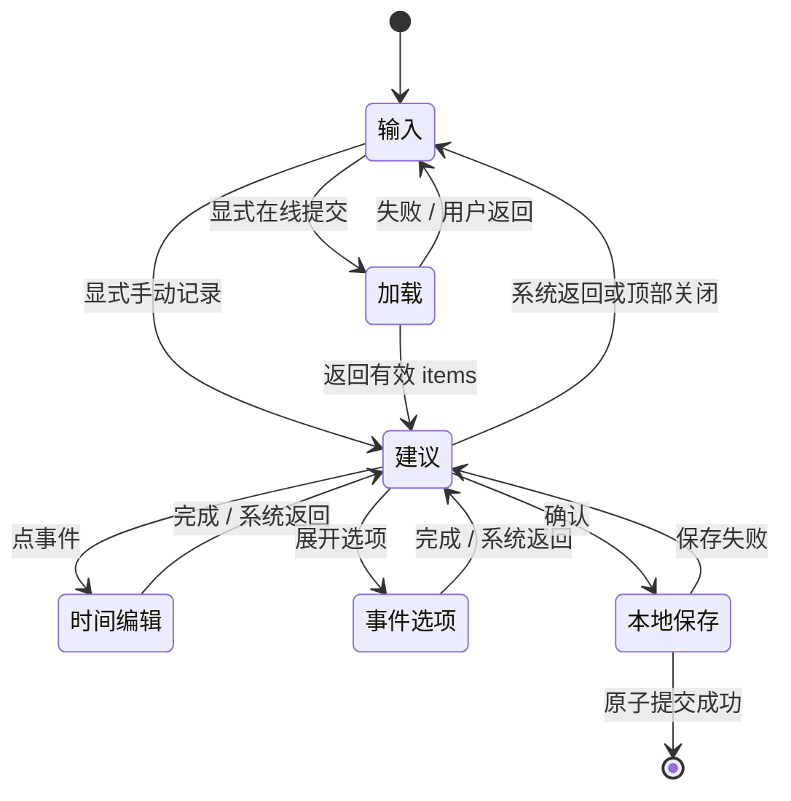

# 事项 V1：架构、数据与接口

本文描述 Android 事项改版的首版实现，覆盖 `1.0.54 / code55` 到 `1.1.3 / code59`。改版前基线为 [`62e5a2a`](https://github.com/csensicrigley-netizen/stu-assistant/tree/62e5a2a03af0a04918965175b7225b8ab46b7e88)，功能合入结点为 [`cc59496`](https://github.com/csensicrigley-netizen/stu-assistant/tree/cc59496d1ec01f33b81d90a2f5e30524db316e5e)。后续整理提交可以更新导入、注释和文档；业务能力以此首版范围为准。

Android 源码在本仓库，智能日历推理服务在独立的 [`0error0warning/smart-calendar`](https://github.com/0error0warning/smart-calendar)。本文核对的后端源码为 [`6e9e352`](https://github.com/0error0warning/smart-calendar/tree/6e9e352c268a1c76fa6d2e418652528936135d7a)，接口说明见其 [Native mobile inference](https://github.com/0error0warning/smart-calendar/blob/6e9e352c268a1c76fa6d2e418652528936135d7a/docs/native-mobile-inference.md)。这些引用说明代码契约，不代替实时服务器检查或供应商数据保留承诺。

## 1. 系统分工



| 组件 | 负责 | 不应承担 |
| --- | --- | --- |
| Android | 记录与人工修改、三天视图和手势、确认、完成状态、本地保存 | 保存 Jev Key、后台静默分析课程、把动画完成当成保存成功 |
| STU 原有后端 | 助手账号、学校账号接入、课程与学校数据同步、既有旧计划接口 | 因引入日历而自动迁移整套学校系统或承接新事项主记录 |
| smart-calendar 移动接口 | 本次输入的 Jev + Duckling 推理、身份验证、用量治理、返回紧凑字段 | 为 App 创建可远端重读的预览或保存新事项 |
| Jev 与确定性解析 | Jev 判断语义角色及有限候选；Duckling 和代码负责候选与时间计算 | 引入另一个生成式 LLM 或让自由生成文本代替规范字段 |

新建智能事项使用设备本地存储。这个边界不等于既有 STU 学校采集系统也已变成本地系统；两条数据链路须分别理解。

## 2. Android 文件职责

以下文件位于 `web/android/app/src/main/java/com/stuassistant/app/`。

| 文件 | 职责 |
| --- | --- |
| [NativeActivity.kt](../web/android/app/src/main/java/com/stuassistant/app/NativeActivity.kt) | 保留主导航，在原生事项入口挂载 Composer；分开页面内容采样和当前页纯背景采样 |
| [NativeItemsScreen.kt](../web/android/app/src/main/java/com/stuassistant/app/nativeapp/NativeItemsScreen.kt) | 事项首页、日期列表、学业子页、详情展开、完成开关；保留页面和日期往返的状态 |
| [NativeItemsDomain.kt](../web/android/app/src/main/java/com/stuassistant/app/nativeapp/NativeItemsDomain.kt) | 展示学校截止精度；不能把仅日期来源的内部排序值显示为真实 `23:59` |
| [NativeCalendarComposer.kt](../web/android/app/src/main/java/com/stuassistant/app/nativeapp/NativeCalendarComposer.kt) | 输入、键盘、显式提交、加载、建议、精确时间与事件选项、本地确认，以及返回和取消 |
| [NativeCalendarDomain.kt](../web/android/app/src/main/java/com/stuassistant/app/nativeapp/NativeCalendarDomain.kt) | canonical 草稿访问和局部修改，生成可显示的 `CalendarMark`；五分钟吸附 |
| [NativeCalendarScreen.kt](../web/android/app/src/main/java/com/stuassistant/app/nativeapp/NativeCalendarScreen.kt) | 三天日期列、共享小时栏、只读背景与当前草稿、自动取景，以及紧凑的精确时间编辑器 |
| [NativeCalendarLayout.kt](../web/android/app/src/main/java/com/stuassistant/app/nativeapp/NativeCalendarLayout.kt) | 按日裁剪、重叠分列、时间到像素的统一几何映射；显示裁剪不改变真实时刻 |
| [NativeCalendarGestures.kt](../web/android/app/src/main/java/com/stuassistant/app/nativeapp/NativeCalendarGestures.kt) | 单一指针所有者，负责平移、双指缩放、移动、跨列改期、上下调整、点转段、长按创建与滚动触感 |
| [NativeCalendarEdge.kt](../web/android/app/src/main/java/com/stuassistant/app/nativeapp/NativeCalendarEdge.kt) | 日历视窗上下渐隐、两级局部模糊与轻微透镜色散；仅采样日历自身 |
| [NativeCalendarCounter.kt](../web/android/app/src/main/java/com/stuassistant/app/nativeapp/NativeCalendarCounter.kt) | 时间与日期的逐字符动画；快速更新保持可见、带轻微模糊，停止后清晰落定 |
| [NativeSoftEdge.kt](../web/android/app/src/main/java/com/stuassistant/app/nativeapp/NativeSoftEdge.kt) | 共用页面和抽屉滚动内容的顶部柔化，独立于日历上下材质；接入点为 `NPage` 和 `NativeModal` |
| [NativeStore.kt](../web/android/app/src/main/java/com/stuassistant/app/nativeapp/NativeStore.kt) | 固定服务接入、身份变更检查、本地事项读写和批次幂等、旧计划调用 |
| [NativeApi.kt](../web/android/app/src/main/java/com/stuassistant/app/nativeapp/NativeApi.kt) | HTTP、路径和大小约束、取消、超时和错误映射；推理 POST 不自动重发 |
| [NativeSecureStorage.kt](../web/android/app/src/main/java/com/stuassistant/app/nativeapp/NativeSecureStorage.kt) | 设备 Keystore、AES-GCM、作用域绑定、私有密文与原子文件提交 |
| [NativeState.kt](../web/android/app/src/main/java/com/stuassistant/app/nativeapp/NativeState.kt) | 原始学校记录与 UI 状态；`calendarRevision` 触发本地重读，批次和日期负责保存后的定位 |

UI 不直接访问文件、Jev Key 或学校提交接口。渲染和命中判断都调用同一套 `calendarBoxes`，避免视觉对象与触摸区域各自计算后发生错位。

## 3. 输入、建议与确认状态机



- 进入输入阶段自动聚焦并唤起键盘。输入栏保持锚点，提交后从按钮处展开柔边圆形蒙版，加载与结果在中间稳定区域过渡。
- 在线请求只在用户提交时发起。拖动、缩放、精确编辑、事件选项和确认均不重新调用推理。
- 手动记录从同一输入内容创建本地草稿，初始没有时间段和默认时长；不会调用 Jev。用户随后可主动安排时间。
- `phase`、文本和打包后的草稿可保留界面状态，网络 `Job` 不持久化。若重建页面时只剩 `loading` 而没有请求任务，回到输入并提示中断，由用户决定是否重试。
- 返回会优先退出时间编辑或选项，再从建议回输入；退出输入才关闭 Composer。正在保存时不再接受返回或重复确认。
- 退出页面会取消本地网络任务，但取消不证明供应商没有处理过请求，也不构成安全自动重发的依据。

事项首页与新建建议页是两种布局：建议页一屏完成，只有中间日历视窗独立平移/缩放；首页仍是可滚动的事项清单。学业入口依次进入“学业 → 考试安排/课程成绩”，系统返回按相反层级恢复页面。

完成开关与详情是两个独立点击目标。完成后记录原位保留，可立即取消；标题和箭头展开详情。旧云计划的完成请求尚未返回时禁止重复发送同一行请求，本地记录刷新时不先清空整组列表。

## 4. 七个顶层字段与时间语义

App 使用后端 v2 紧凑模型 [`ItemDraftInput`](https://github.com/0error0warning/smart-calendar/blob/6e9e352c268a1c76fa6d2e418652528936135d7a/src/smart_calendar/api/item_models.py)，不恢复旧版的常驻 `kind`、`scheduled_start`、`pending_temporal` 等重复字段。

| 字段 | 语义 | 当前 App 表现 |
| --- | --- | --- |
| `title` | 事项标题 | 列表与事件对象显示；建议页标题固定为“建议”，不假定已提取唯一主事件 |
| `timezone` | IANA 时区 | 当前移动端发送 `Asia/Shanghai`，参考时刻包含偏移 |
| `plan` | 日期范围与可选模糊时段 | 保留日期窗口，展示计划；不假装成精确占用时段 |
| `deadline` | 日期截止或精确时刻截止 | 日期截止保持日期，精确截止在日历显示为线和圆点 |
| `schedule` | 精确开始，结束可空 | 只有 `start` 是点事件；有真实 `end` 才是时间段 |
| `reminders` | 提醒意图列表 | 保留并可配置部分常用意图；本版不执行设备通知 |
| `details` | 备注、优先级及可选估时等次级信息 | 按需展开事件选项，避免把所有字段常驻铺在页面 |

补充约束：

1. `plan.start_date` 包含起日，`end_date_exclusive` 不包含末日；可选 `part_of_day` 保留上午、下午、晚上等精度。详情展示时可转换为用户可读的包含末日范围，底层值不改。
2. `deadline.kind=date` 使用日期与 `boundary=on/before/by`，还可带模糊时段；`kind=instant` 使用带时区时刻及 `boundary=before/by`。不能把日期截止补成零点或虚构 `23:59`。
3. `schedule.end` 可缺省；没有结束不补一小时。点、段、截止是时间语义，不能仅凭 UI 的矩形或圆点互相改写。
4. 提醒使用 `absolute.at`、`relative.anchor=deadline/start/end` 与 `offset_minutes`，或 `window.window`。这里是 v2 字段，不混用旧接口的 `trigger_at`、`scheduled_start` 等名称。
5. `details` 可含 `note`、`priority`（0–2）、`estimated_minutes`、`preferred_completion`。后端允许字段存在，不等于 App 已为每项提供完整独立编辑功能。
6. 同一草稿可以同时包含计划、固定安排、截止和提醒；它们不是互斥分类。局部操作只修改所属字段，例如拖截止不删除原安排和备注。

三天网格当前只为精确 `schedule` 与精确 `deadline` 生成对象。仅日期的计划/截止仍保留在草稿与列表中，用户可主动补充准确安排；本版没有把它们实现成完整的全天事件区。首页的主要日期由安排、截止、计划依次取得，并非同一事项的所有时间关系都已展开为独立日期引用。

## 5. 三天日历、手势与动效职责

默认以当前选中日期为中列，左右分别为前一天和后一天，三列共用小时栏。选中事项触发自动取景；用户可把时间窗缩放到 120–1440 分钟。自动取景最少展示六小时，时间段较长时扩大范围；刻度密度随视窗变化。

`calendarDaySlots` 对跨日段只做显示裁剪，实际 `CalendarMark.start/end` 保持原值。相交事件在同日内分列；一个事件结束时另一个恰好开始，不算重叠。最小可见高度与点抓手是显示/命中尺寸，不代表给模型结果添加了时长。

| 操作 | 处理规则 |
| --- | --- |
| 空白单指移动 | 平移当前时间窗，不滚动整张建议页 |
| 双指缩放 | 以双指中心调整视窗；在事件上也可生效，出现第二指时撤销该手势内临时事件位移 |
| 拖时间段主体 | 连续跟手预览；跨入相邻日期列改变日期，保持时长 |
| 拖上/下抓手 | 分别调整开始或结束；没有实际处于该日的隐藏跨日端点不提供对应调整 |
| 拖点或截止线 | 改变该点时间，截止保持截止语义，不增加占用时长 |
| 普通点的空心抓手 | 可拉出时间段；时间段下端收回可还原为点 |
| 长按空白 | 在对应日期列主动建立准确安排 |
| 松手/取消 | 松手吸附到五分钟；取消时恢复本手势前的值 |

监听器用最新回调和数据引用，视窗变化不重新创建当前指针会话。缩放后的剩余单指会被消费，不能误接成拖事件。直接拖动选择另一个事项时保留原视窗，避免把时间轴突然重新居中。

滚动触感在手动平移跨越当前次刻度时触发，间隔至少 80ms；快速跨过多个刻度不排队补震。静止、程序定位和缩放不额外触发该刻度反馈，强度和开关沿用 App 设置。

数字动画、日期切换和蒙版只负责呈现，不参与业务时刻计算。日历上下材质采样日历自身，按钮采样当前页纯背景；全局顶部柔化处理当前滚动层。禁止为视觉效果采样包含效果自身的层，或重新透出被盖住首页的元素。参数和来源见 [DESIGN.md](../DESIGN.md) 与 [顶部 Soft Edge](顶部SoftEdge.md)。

## 6. 移动接口契约

### 6.1 地址与身份

- App 固定通过 `https://stu-mcp.com/api/calendar/v2/mobile/parse` 请求推理；反向代理转发到后端内部的 `POST /v2/mobile/parse`。
- 此移动接口接受已有 STU Bearer 会话。后端只向固定 `https://stu.oyishi.asia/v1/me` 验证，拒绝 demo 用户、重定向和无法确认的身份；不接受调用者指定任意身份来源。
- App 当前仅在助手服务器为 `https://stu.oyishi.asia` 时启用此在线接入。会话签名密钥和 Jev Key 不进入 APK。
- `ItemParseRequest.text` 长度为 1–200 字符；必填 `context.reference_at` 和 `context.timezone`。后端还支持 `entry_context`，当前 Android 请求只发送文本和参考上下文。

### 6.2 合成请求和响应形状

以下仅演示已核对的 schema，不是一次模型实测结果，也不保证相同自然语言总会产生该示例标题。

```http
POST /api/calendar/v2/mobile/parse
Authorization: Bearer <STU 会话，仅运行时使用>
Content-Type: application/json
```

```json
{
  "text": "2026年11月3日下午2点到3点和导师开会",
  "context": {
    "reference_at": "2026-11-01T10:00:00+08:00",
    "timezone": "Asia/Shanghai"
  }
}
```

```json
{
  "items": [
    {
      "id": "item_0",
      "draft": {
        "title": "2026年11月3日下午2点到3点和导师开会",
        "timezone": "Asia/Shanghai",
        "schedule": {
          "start": "2026-11-03T14:00:00+08:00",
          "end": "2026-11-03T15:00:00+08:00"
        },
        "reminders": []
      },
      "issues": []
    }
  ],
  "issues": []
}
```

响应为 `InferenceResult`：1–8 个 `items`，每项为 `id`、`draft`、`issues`；还可含整体 `issues`。临时 `item_0`–`item_7` 只是本次结果中的标识，不是已保存的记录 ID。

问题项只给受限 `field` 与 `reason`（`incomplete/conflict/uncertain/unsupported`）。App 保留草稿，读取问题项决定复核状态；不把存在问题的结果改成模板成功。响应没有远端 preview ID、修订号或重新获取原结果的地址。

### 6.3 超时、错误与重试

`NativeApi` 对该移动请求设置 90 秒完整请求期限，禁用重定向；取消会尝试断开连接。网络 POST 仅尝试一次。普通 GET 的有限读重试规则不适用于推理 POST。

| 情况 | App 行为 |
| --- | --- |
| 401 | 回到输入，提示会话过期，保留可重新操作路径 |
| 429 | 提示频率或用量上限，等待用户后续操作 |
| 超时/504 | 明确结果未知，由用户自行决定是否重试 |
| 网络错误、服务不可用、无效响应 | 不制造成功结果，允许手动重试或手动记录 |
| 用户返回/关闭 | 尽力取消，旧结果不再应用到已退出或切换的账号 |
| 本地保存失败 | 停留建议页并显示本地错误，不因存储失败重新调用 Jev |

后端错误使用受限的 `error.code/message/retryable` 等字段；App 不把供应商原始错误或堆栈直接显示给用户。后端 `retryable` 元数据也不等于允许客户端自动重放一次结果未知的付费推理。

## 7. 服务端解析、路由与治理

代码入口是后端 [`item_previews.py`](https://github.com/0error0warning/smart-calendar/blob/6e9e352c268a1c76fa6d2e418652528936135d7a/src/smart_calendar/api/item_previews.py) 的移动路由。它进入 `infer_record`，调用模型操作时显式设置 `persist_preview=False`，再映射为紧凑 `items/issues`。

解析管线复用 [`jev_parser.py`](https://github.com/0error0warning/smart-calendar/blob/6e9e352c268a1c76fa6d2e418652528936135d7a/src/smart_calendar/application/jev_parser.py)：Duckling 提供时间候选，Jev 对事项归属、语义角色、精度和有限候选等作类型化判断，确定性代码完成时区/日期计算和领域校验。候选与证据范围还要与输入文字核对。此链路使用 Jev 的类型化接口，不另接生成式 LLM 来理解整句，也不把自由生成文本当作规范字段。

治理与 Key 路由是两层：

| 层 | 入口与存储 | 作用 |
| --- | --- | --- |
| 系统用量治理 | [`application/governance.py`](https://github.com/0error0warning/smart-calendar/blob/6e9e352c268a1c76fa6d2e418652528936135d7a/src/smart_calendar/application/governance.py) | 模型调用前原子预留全局/认证主体的分钟、日、并发和单位额度；逻辑请求重读策略，约束整套系统用量 |
| Key 可用性路由 | [`adapters/key_pool.py`](https://github.com/0error0warning/smart-calendar/blob/6e9e352c268a1c76fa6d2e418652528936135d7a/src/smart_calendar/adapters/key_pool.py) | 按权重归一化的在途负载、最近使用等选择可用 Key，维护租约和可用性；不替用户决定成本策略 |

限流 Key 冷却后再恢复；明确额度耗尽和认证失败的 Key 被跳过。只有明确、经过映射的限流/额度/认证错误才可在本次路由内尝试其他 Key。超时、连接中断和无效供应商响应可能已产生调用，按未知结果计量，不能直接换 Key 自动重放。

移动入口在启用 `SC_ACCESS_DB` 时还应用模型前的 IP 准入和无内容访问台账。代码默认每分钟 20 次、保留 14 天、最多 100000 条，记录随机请求 ID、可信来源 IP、时间、认证主体、HTTP 状态和耗时。它只在本机代理连接上接受由入口覆盖的专用 IP 头，不信任任意客户端的 `Forwarded/X-Forwarded-For`。这些是代码中的默认与配置契约，不是本文对当前线上配置值的重新验收。

移动路由不保存输入、草稿、模型答案或内容哈希。用量、访问元数据和 Key 可用性状态不是业务恢复库。旧 v1/v2 私有预览兼容接口及其历史记录仍可能存在，不能把移动路由无状态扩大解释为旧数据库已被清空。旧端点处理、运维日志和实际部署策略须独立核查。

## 8. 本地记录、原子确认与账号生命周期

`NativeStore.calendarKey()` 以 `calendar-v1:` 加“服务器 + 助手账号 ID”的命名空间，与原有学校快照缓存分开。保存记录形状由 Android 自己生成：

```text
items[]:
  id          新建的本地 UUID
  batch       本次 Composer 的确认批次 UUID
  draft       canonical 七字段草稿
  done        设备完成状态
  created_at  本地创建时间
```

该形状是本地记录，不应发送到推理服务充当远端持久化。`saveCalendar` 在同一锁内读取、检查批次、追加整组 1–8 条记录并原子写入；若已有同一批次则直接返回，避免重复确认复制事项。确认成功后才更新 `calendarRevision` 和首页定位信息。

安全存储复用 [NativeSecureStorage](../web/android/app/src/main/java/com/stuassistant/app/nativeapp/NativeSecureStorage.kt)：

- Android Keystore 生成 AES-256 密钥，使用 AES-GCM、随机 IV 与身份/用途绑定的附加认证数据。
- 文件名是作用域的摘要，密文放在 App 私有 `noBackupFilesDir`。文件名隐藏不构成加密；真正的数据保护来自 Keystore 与认证加密。
- `AtomicFile` 写入后同步文件描述符并读回校验密文，再报告成功；失败走原子文件恢复路径。
- 缺失设备密钥或解密失败时抛出受限错误，不把密文当空文件、不生成新空数据库覆盖原数据。
- 事项读方法返回副本，界面草稿和显示裁剪不直接改变已保存记录。

| 生命周期 | 新事项本地记录 | 其他状态 |
| --- | --- | --- |
| 正常重开或升级 | 按同一服务器/账号重新读取 | 不因页面缓存刷新重复确认 |
| 切换账号/服务器 | 不共用事项作用域；Composer 校验预期账号，迟到写入被拒绝 | 事项子页、错误和忙碌状态按账号重建 |
| 退出登录 | 保留独立的日历本地记录，重新登录同一账号可读 | 会话及原有学校快照缓存按既有登出逻辑清理 |
| 删除账号 | 服务器确认删除后清除当前账号对应日历缓存 | 再清理原有会话和相关本机账号数据 |
| 卸载/清除数据/设备密钥丢失 | 本版没有服务器恢复副本 | 不能承诺仅重装或下载源码即可恢复 |

这里的批次幂等只保证本地确认不重复，不等于模型供应商严格只处理一次，也不是下一轮课程活动的增量分类账本。

## 9. 旧数据与首版边界

已有课程、未完成本地事项及旧 STU 计划可以作为日历背景。只有当前新建批次的对象可在建议页直接拖动；背景对象的 `item` 不具备编辑索引。旧计划仍可在列表通过既有 STU 计划接口标记完成，它们没有被静默迁移或删除。课程和学校提交状态依旧只读，App 勾选不等于向学校交作业。

以下能力未计入已完成的事项 V1：

- **课程 Jev 分类与本地增量账本**：当前课程动态仅显示同步结果，并标为“未分类”。用户已明确留到下一轮。未来须按可靠的账号/课程/活动身份一次分类，普通标题、截止、状态和模型版本更新不能自动重问；具体设计见后端 [MySTU 本地分类规范](https://github.com/0error0warning/smart-calendar/blob/6e9e352c268a1c76fa6d2e418652528936135d7a/docs/mystu-incremental-classification.md)。
- **提醒执行**：保存的是意图，未接设备通知调度、提醒生命周期或厂商实时通知业务。事件选项明确提示通知尚未启用。
- **自动找空闲与重排**：现有安排只是视觉上下文，不是已实现的冲突优化、自动避课、自动择时或自动重新排程。
- **完整事项 CRUD**：新建草稿可编辑、确认后可查看和切换完成；已保存事项的完整编辑、删除、排序及批量管理没有因此自动交付。
- **全天区和重复规则**：日期语义保留，不代表已有完整全天事件区；重复安排、复杂依赖等不能在文档里算作已实现。
- **云同步与恢复**：新事项没有云端主记录或跨设备恢复；旧系统仍存在不意味着新增了隐式日历同步。

原生实现、服务器契约、模拟器测试、真机手感与生产发布是不同证据。本文说明结构和边界；具体执行过的版本、测试及交付应以本轮总说明、构建回执和相应测试记录为准。
